# Лабораторна робота 2. Створення складних SQL запитів

## Загальна інформація

**Здобувач освіти:** [Кравчук Владислав Вікторович]
**Група:** [ІПЗ-31]
**Обраний рівень складності:** [2]

## Виконання завдань

### Рівень 1

#### 1. З'єднання таблиць

**Завдання 1.1:** INNER JOIN - список товарів з категоріями та постачальниками

```sql
-- Вставте ваш SQL код тут
SELECT
    p.product_name,
    c.category_name,
    s.company_name,
    p.unit_price
FROM products p
INNER JOIN categories c
    ON p.category_id = c.category_id
INNER JOIN suppliers s
    ON p.supplier_id = s.supplier_id
ORDER BY c.category_name, p.product_name;
```

**Результат виконання:**
```
-- Вставте скріншот або текст результату (перші 10 рядків)

```
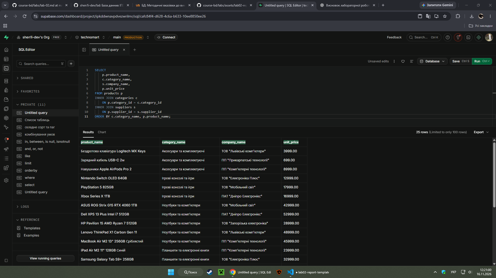
**Пояснення:** Запит з 'єднує таблиці products, categories та suppliers за допомогою INNER JOIN. Він виводить назви товарів, їхні категорії, постачальників та ціни. У результат потрапляють лише ті записи, для яких знайдено відповідність у всіх трьох таблицях.


**Завдання 1.2:** LEFT JOIN - клієнти з кількістю замовлень

```sql
-- Вставте ваш SQL код тут
SELECT
    c.contact_name,
    c.customer_type,
    r.region_name,
    COUNT(o.order_id) AS order_count
FROM customers c
LEFT JOIN orders o
    ON c.customer_id = o.customer_id
LEFT JOIN regions r
    ON c.region_id = r.region_id
GROUP BY
    c.customer_id,
    c.contact_name,
    c.customer_type,
    r.region_name
ORDER BY order_count DESC;
```

**Результат виконання:**
```
-- Вставте результат
```
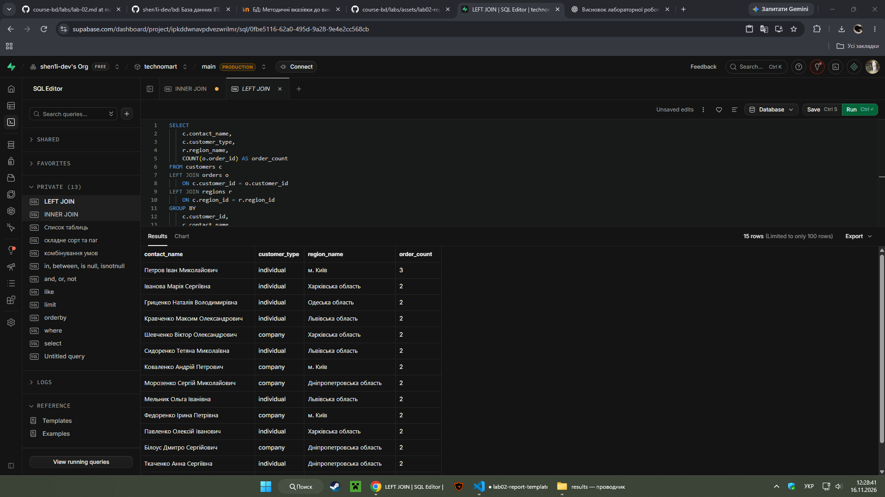
**Пояснення:** INNER JOIN повертає лише записи, які мають відповідності в обох таблицях. LEFT JOIN повертає всі записи з лівої таблиці, навіть якщо відповідних записів у правій таблиці немає. У такому випадку значення правої таблиці будуть NULL.


**Завдання 1.3:** Множинне з'єднання - детальна інформація про замовлення

```sql
-- Вставте ваш SQL код тут (з'єднання 4-5 таблиць)
SELECT
    o.order_id,
    o.order_date,
    p.product_name,
    c.category_name,
    s.company_name AS supplier,
    oi.quantity,
    oi.unit_price
FROM orders o
JOIN order_items oi
    ON o.order_id = oi.order_id
JOIN products p
    ON oi.product_id = p.product_id
JOIN categories c
    ON p.category_id = c.category_id
JOIN suppliers s
    ON p.supplier_id = s.supplier_id
WHERE o.order_date >= '2024-01-01'
ORDER BY o.order_date DESC;
```

**Результат виконання:**
```
-- Вставте результат

```
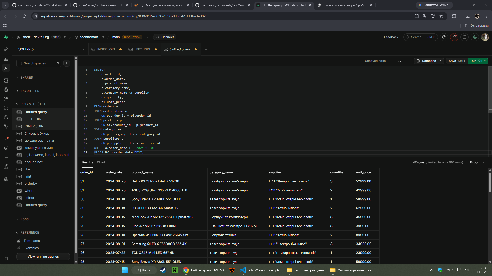
**Аналіз складності:** Запит об'єднує п'ять таблиць orders, order_items, products, categories та suppliers. Спочатку отримуються замовлення, потім до них приєднуються товари, іхні категорії та постачальники. У результаті формується детальна інформація про замовлення.
Запит має середню складність, оскільки використовує чотири операції з'єднання п'яти таблиць. Послідовність дає повну інформацію про замовлення та пов'язані з ними товари. Для сортування результатів використовується ORDER BY.


#### 2. Агрегатні функції

**Завдання 2.1:** Статистика товарів за категоріями

```sql
-- COUNT, AVG, MIN, MAX по категоріях
SELECT
    c.category_name,
    COUNT(p.product_id) AS product_count,
    AVG(p.unit_price) AS avg_price,
    MIN(p.unit_price) AS min_price,
    MAX(p.unit_price) AS max_price
FROM categories c
LEFT JOIN products p
    ON c.category_id = p.category_id
GROUP BY c.category_id, c.category_name
ORDER BY product_count DESC;
```

**Результат виконання:**
```
-- Результат

```
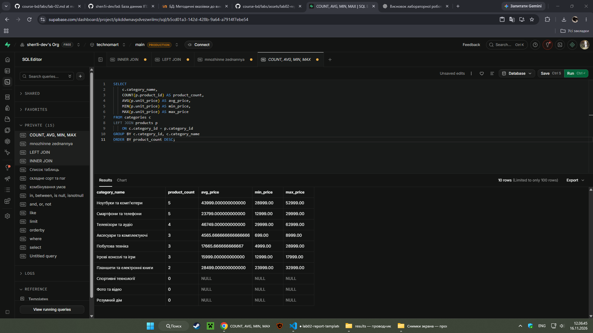
**Завдання 2.2:** Продажі за регіонами з використанням HAVING

```sql
-- SUM, GROUP BY, HAVING
SELECT
    r.region_name,
    SUM(
        oi.quantity * oi.unit_price *
        (1 - COALESCE(oi.discount, 0))
    ) AS total_sales
FROM regions r
JOIN customers c
    ON r.region_id = c.region_id
JOIN orders o
    ON c.customer_id = o.customer_id
JOIN order_items oi
    ON o.order_id = oi.order_id
GROUP BY r.region_id, r.region_name
HAVING SUM(
    oi.quantity * oi.unit_price *
    (1 - COALESCE(oi.discount, 0))
) > 0
ORDER BY total_sales DESC;
```

**Результат виконання:**
```
-- Результат

```
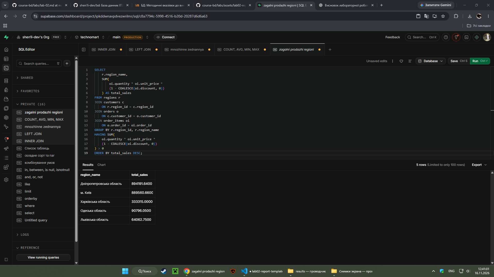
**Завдання 2.3:** Постачальники з кількістю товарів більше 2

```sql
-- Запит з HAVING
SELECT
    s.company_name,
    COUNT(p.product_id) AS product_count
FROM suppliers s
JOIN products p
    ON s.supplier_id = p.supplier_id
GROUP BY s.supplier_id, s.company_name
HAVING COUNT(p.product_id) > 2
ORDER BY product_count DESC;
```

**Результат виконання:**
```
-- Результат

```
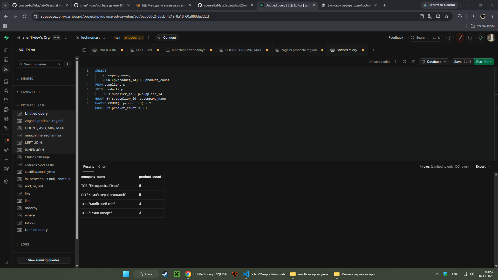


#### 3. Базові підзапити

**Завдання 3.1:** Товари з ціною вище середньої по категорії

```sql
-- Корельований підзапит
SELECT
    p.product_name,
    p.unit_price,
    c.category_name
FROM products p
INNER JOIN categories c
    ON p.category_id = c.category_id
WHERE p.unit_price > (
    SELECT AVG(p2.unit_price)
    FROM products p2
    WHERE p2.category_id = p.category_id
)
ORDER BY c.category_name, p.unit_price DESC;
```

**Результат виконання:**
```
-- Результат

```
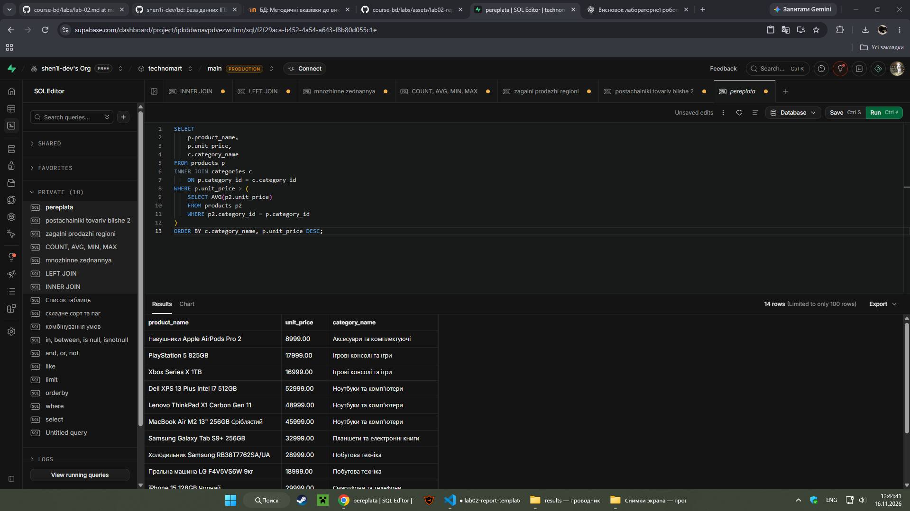
**Завдання 3.2:** Клієнти з замовленнями у 2024 році

```sql
-- Підзапит з IN
SELECT
    c.customer_id,
    c.contact_name
FROM customers c
WHERE c.customer_id IN (
    SELECT o.customer_id
    FROM orders o
    WHERE o.order_date >= '2024-01-01'
      AND o.order_date < '2025-01-01'
)
ORDER BY c.contact_name;
```

**Результат виконання:**
```
-- Результат

```
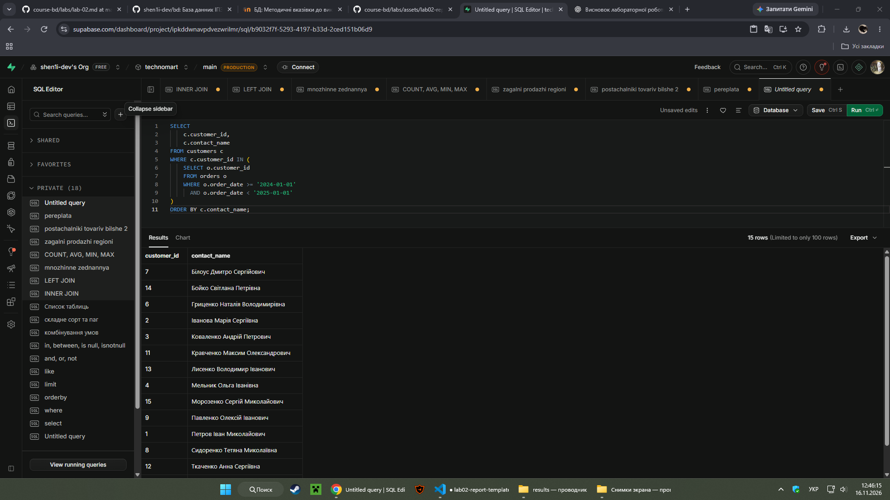
**Завдання 3.3:** Товари з загальною кількістю продажів

```sql
-- Підзапит у SELECT
SELECT
    p.product_name,
    (
        SELECT COALESCE(SUM(oi.quantity), 0)
        FROM order_items oi
        WHERE oi.product_id = p.product_id
    ) AS total_sold
FROM products p
ORDER BY total_sold DESC;
```

**Результат виконання:**
```
-- Результат
```
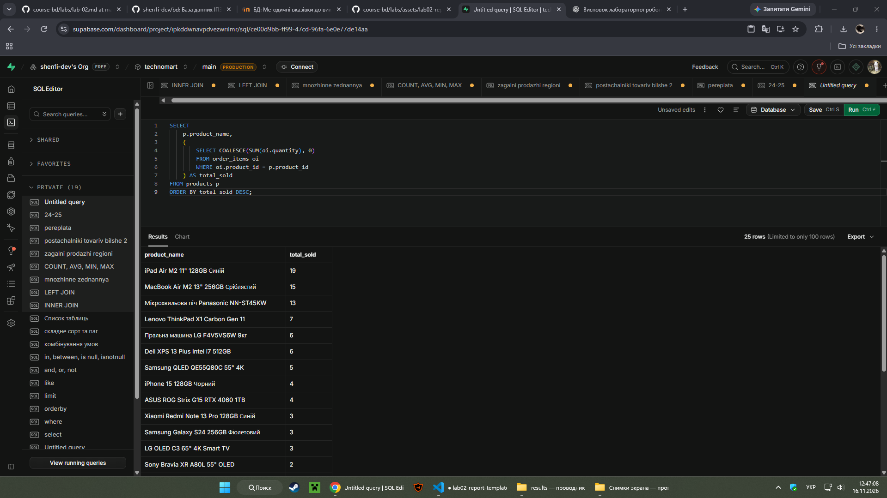


### Рівень 2

#### 4. Складні з'єднання

**Завдання 4.1:** RIGHT JOIN - аналіз категорій та товарів

```sql
-- RIGHT JOIN код
SELECT
    c.category_name,
    COUNT(p.product_id) AS products_count,
    COALESCE(AVG(p.unit_price), 0) AS avg_price
FROM products p
RIGHT JOIN categories c
    ON p.category_id = c.category_id
GROUP BY c.category_id, c.category_name
ORDER BY products_count DESC;
```

**Результат виконання:**
```
-- Результат

```
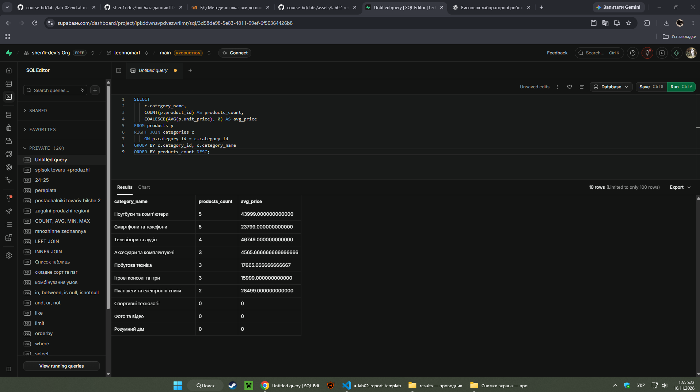
**Завдання 4.2:** Self-join - співробітники та керівники

```sql
-- Self-join код
SELECT
    e1.first_name || ' ' || e1.last_name AS employee,
    e1.title AS employee_title,
    e2.first_name || ' ' || e2.last_name AS manager,
    e2.title AS manager_title
FROM employees e1
LEFT JOIN employees e2
    ON e1.reports_to = e2.employee_id
ORDER BY e2.last_name, e1.last_name;
```
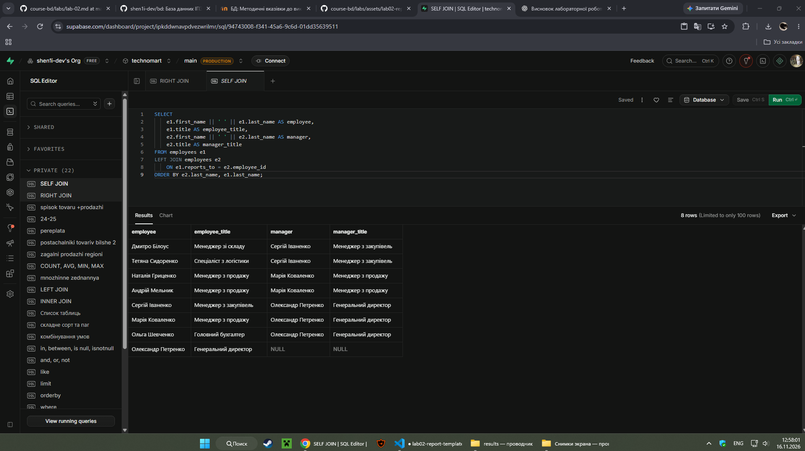
**Результат виконання:**
```
-- Результат

``` 

```  
-- Додані завдання(є в загальних вимогах 2 рівня але нема в звіті)

``` 
**Завдання 4.3:** FULL OUTER JOIN - показати всі категорії та товари.

```sql
-- фул оутер джоін код
SELECT
    c.category_name,
    p.product_name,
    p.unit_price
FROM categories c
FULL OUTER JOIN products p
    ON c.category_id = p.category_id
ORDER BY c.category_name, p.product_name;
```

**Результат виконання:**
```
-- Результат

```
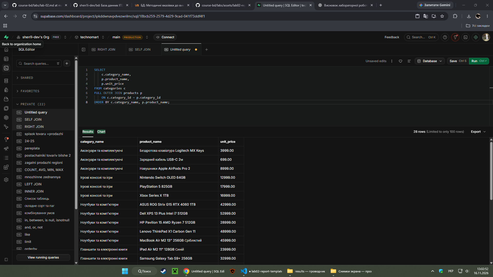
**Завдання 4.4:** Умовне з'єднання - показати клієнтів та їхні замовлення після 2024 року.

```sql
-- після 24 року код
SELECT
    c.contact_name,
    c.customer_type,
    o.order_id,
    o.order_date
FROM customers c
LEFT JOIN orders o
    ON c.customer_id = o.customer_id
    AND o.order_date >= '2024-01-01'
ORDER BY c.contact_name, o.order_date;
```
**Результат виконання:**
```
-- Результат

```
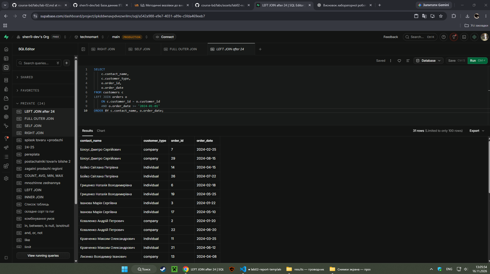
#### 5. Віконні функції

**Завдання 5.1:** Ранжування товарів за ціною в категоріях

```sql
-- RANK(), DENSE_RANK(), ROW_NUMBER() код
SELECT
    p.product_name,
    c.category_name,
    p.unit_price,

    ROW_NUMBER() OVER (
        PARTITION BY c.category_name
        ORDER BY p.unit_price DESC, p.product_id
    ) AS row_num,

    RANK() OVER (
        PARTITION BY c.category_name
        ORDER BY p.unit_price DESC
    ) AS price_rank,

    DENSE_RANK() OVER (
        PARTITION BY c.category_name
        ORDER BY p.unit_price DESC
    ) AS price_dense_rank

FROM products p
JOIN categories c
    ON p.category_id = c.category_id
ORDER BY c.category_name, p.unit_price DESC;
```

**Результат виконання:**
```
-- Результат

```
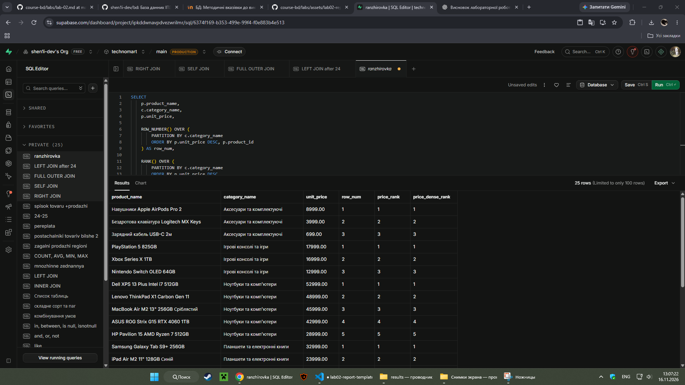
**Завдання 5.2:** Порівняння замовлень з попередніми датами

```sql
-- LAG(), LEAD() код
SELECT
    customer_id,
    order_id,
    order_date,

    LAG(order_date) OVER (
        PARTITION BY customer_id
        ORDER BY order_date, order_id
    ) AS previous_order,

    LEAD(order_date) OVER (
        PARTITION BY customer_id
        ORDER BY order_date, order_id
    ) AS next_order

FROM orders
ORDER BY customer_id, order_date;
```

**Результат виконання:**
```
-- Результат

```
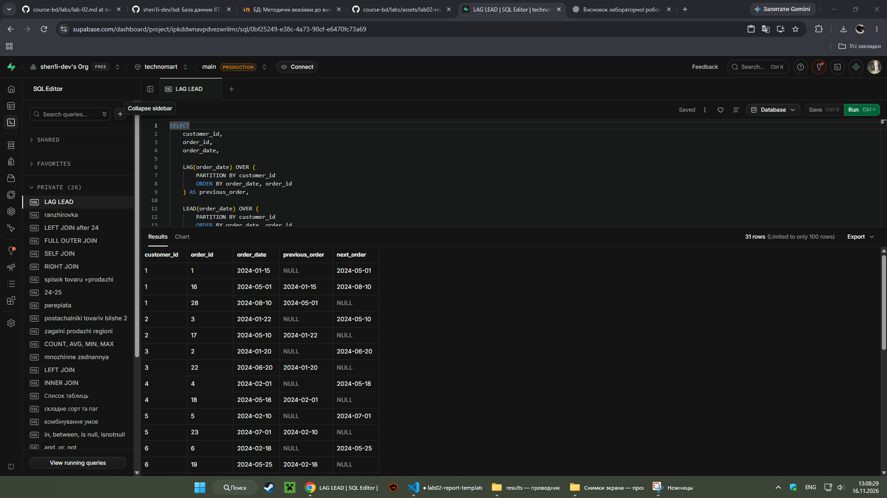


**Час виконання:**
- Віконні функції: [50~]
- Корельований підзапит: [5~]

**Висновок:** Під час порівняння ефективності було розглянуто віконні функції та корельовані підзапити. Віконні функції дозволяють виконувати аналітичні обчислення над групами записів зберігаючи всі рядки результату. Корельовані підзапити використовують дані поточного рядка основного запиту для додаткових обчислень. Було додано до звіту 4.3 та 4.4 завдання для виконання повного 2 рівня. Використовува ШІ для швидкого виконання лабораторноі роботи


## Висновки

**Самооцінка**: [3]

**Обгрунтування**: [здано без дедлайну]
