# Звіт з лабораторної роботи №4

## Загальна інформація
- ПІБ студента:Кравчук Владислав Вікторович
- Група:ІПЗ-31
- Варіант (предметна область):Магазин електроніки та побутової техніки
- Рівень виконання:2 рівень

## Опис предметної області
Предметною областю є магазин електроніки та побутової техніки. Система призначена для обліку товарів, виробників, категорій, покупців, працівників та замовлень. База даних дозволяє зберігати інформацію про товари, їхню вартість, кількість на складі, виробників і покупців. Також передбачено облік замовлень та товарів, які входять до їхнього складу. Основною метою розробки є створення інформаційної системи, яка спрощує роботу магазину та дозволяє швидко отримувати потрібну інформацію про товари й продажі.

## Концептуальна модель
[Опис сутностей, атрибутів та зв'язків]
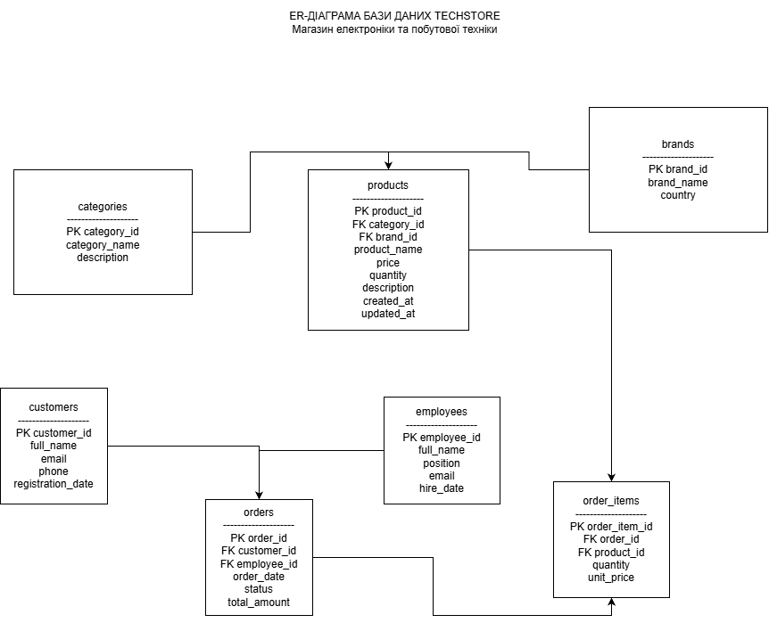

Структура репозиторію:

```
lab4-tech-store/
│
├── README.md
├── docker-compose.yml
├── .env
├── .gitignore
├── requirements.txt
│
├── docs/
│   ├── conceptual_model.md
│   ├── conceptual_model.png
│   └── report.md
│
├── database/
│   ├── schema.sql
│   ├── seed.sql
│   ├── queries.sql
│   ├── functions.sql
│   ├── triggers.sql
│   └── views.sql
│
├── console_app/
│   └── main.py
│
└── web_app/
    ├── app.py
    ├── templates/
    │   ├── index.html
    │   ├── add_product.html
    │   └── edit_product.html
    │
    └── static/
        └── style.css
```
## Логічна схема
categories - Зберігання категорій товарів

brands - Зберігання інформації про бренди

products - Зберігання інформації про товари

customers - Зберігання даних покупців

employees - Зберігання даних працівників

orders - Зберігання замовлень

order_items - Зберігання товарів у замовленнях

## Реалізація в PostgreSQL
[Файл з основними елементами SQL скрипту](lab4-tech-store/database/schema.sql)

Основні елементи SQL скрипту:

1. Створює таблицю для зберігання категорій товарів магазину, їхніх назв та описів.
```
CREATE TABLE categories (
    category_id SERIAL PRIMARY KEY,
    category_name VARCHAR(100) NOT NULL UNIQUE,
    description TEXT
);
```

2. Створює таблицю для зберігання категорій товарів магазину, їхніх назв та описів.
```
CREATE TABLE brands (
    brand_id SERIAL PRIMARY KEY,
    brand_name VARCHAR(100) NOT NULL UNIQUE,
    country VARCHAR(100)
);
```
3. Створює основну таблицю товарів, у якій зберігаються назви, категорії, бренди, ціни, кількість на складі та описи товарів.
```
CREATE TABLE products (
    product_id SERIAL PRIMARY KEY,
    product_name VARCHAR(150) NOT NULL,
    category_id INTEGER NOT NULL REFERENCES categories(category_id),
    brand_id INTEGER NOT NULL REFERENCES brands(brand_id),
    price NUMERIC(10,2) NOT NULL CHECK (price > 0),
    quantity INTEGER NOT NULL DEFAULT 0 CHECK (quantity >= 0),
    description TEXT,
    created_at TIMESTAMP DEFAULT CURRENT_TIMESTAMP,
    updated_at TIMESTAMP DEFAULT CURRENT_TIMESTAMP
);
```
4. Створює таблицю для зберігання особистих і контактних даних покупців та дати їхньої реєстрації.
```
CREATE TABLE customers (
    customer_id SERIAL PRIMARY KEY,
    full_name VARCHAR(150) NOT NULL,
    email VARCHAR(150) NOT NULL UNIQUE,
    phone VARCHAR(20) UNIQUE,
    registration_date DATE DEFAULT CURRENT_DATE
);
```
5. Створює таблицю для зберігання інформації про працівників магазину, їхні посади та контактні дані.
```
CREATE TABLE employees (
    employee_id SERIAL PRIMARY KEY,
    full_name VARCHAR(150) NOT NULL,
    position VARCHAR(100) NOT NULL,
    email VARCHAR(150) NOT NULL UNIQUE,
    hire_date DATE DEFAULT CURRENT_DATE
);
```
6. Створює таблицю для зберігання інформації про замовлення, покупців, відповідальних працівників, статуси та загальну вартість.
```
CREATE TABLE orders (
    order_id SERIAL PRIMARY KEY,
    customer_id INTEGER NOT NULL REFERENCES customers(customer_id),
    employee_id INTEGER REFERENCES employees(employee_id),
    order_date TIMESTAMP DEFAULT CURRENT_TIMESTAMP,
    status VARCHAR(30) NOT NULL DEFAULT 'Нове'
        CHECK (status IN ('Нове', 'Оплачено', 'Відправлено', 'Виконано', 'Скасовано')),
    total_amount NUMERIC(12,2) NOT NULL DEFAULT 0
        CHECK (total_amount >= 0)
);
```
7. Створює таблицю для зберігання переліку товарів у замовленнях, їхньої кількості та ціни за одиницю.
```
CREATE TABLE order_items (
    order_item_id SERIAL PRIMARY KEY,
    order_id INTEGER NOT NULL REFERENCES orders(order_id) ON DELETE CASCADE,
    product_id INTEGER NOT NULL REFERENCES products(product_id),
    quantity INTEGER NOT NULL CHECK (quantity > 0),
    unit_price NUMERIC(10,2) NOT NULL CHECK (unit_price > 0),
    UNIQUE (order_id, product_id)
);
```
## Налаштування Docker
Для запуску бази даних PostgreSQL було використано Docker. У файлі [docker-compose.yml](lab4-tech-store/docker-compose.yml) налаштовано контейнер techstore_db на основі образу PostgreSQL

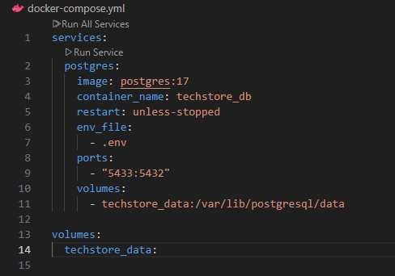

Для підключення до бази даних використовується порт 5433, а для збереження даних створено окремий Docker volume techstore_data.

Для запуску контейнера використано команду:

docker compose up -d

Для перевірки стану контейнера використано команду:

docker ps

після запуску контейнер успішно працює, а підключення до бази даних здійснюється через pgAdmin 4 та вебзастосунок.

## SQL-запити
Всі запити знаходяться в [файл запитів](lab4-tech-store/database/queries.sql)
1. Виведення всіх товарів із таблиці products.
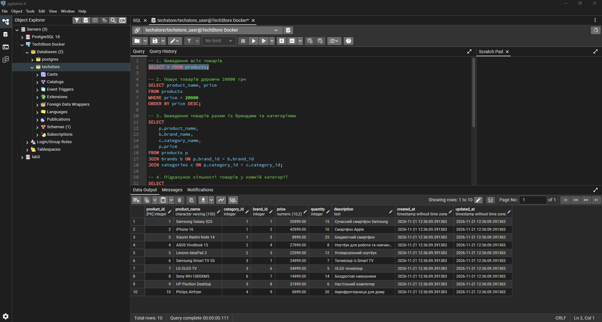
2. Пошук товарів вартістю понад 20000 грн із сортуванням за ціною.
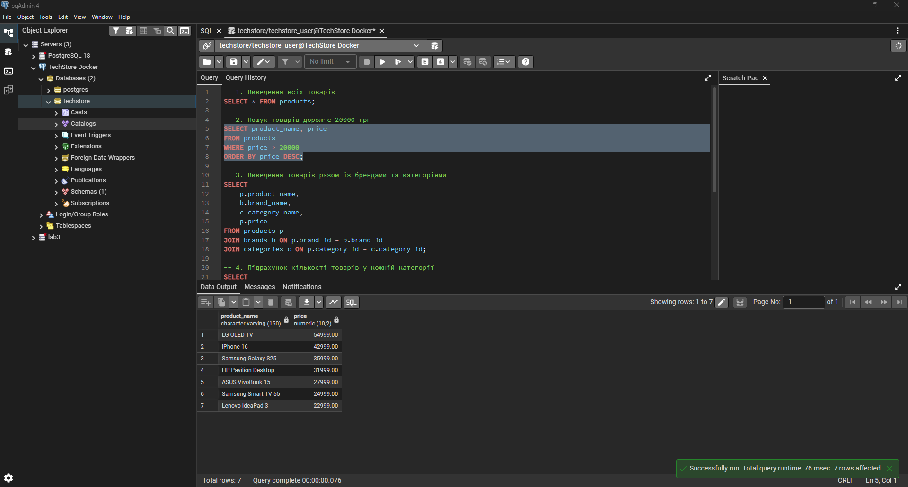
3. Об'єднання таблиць products, brands та categories за допомогою JOIN.
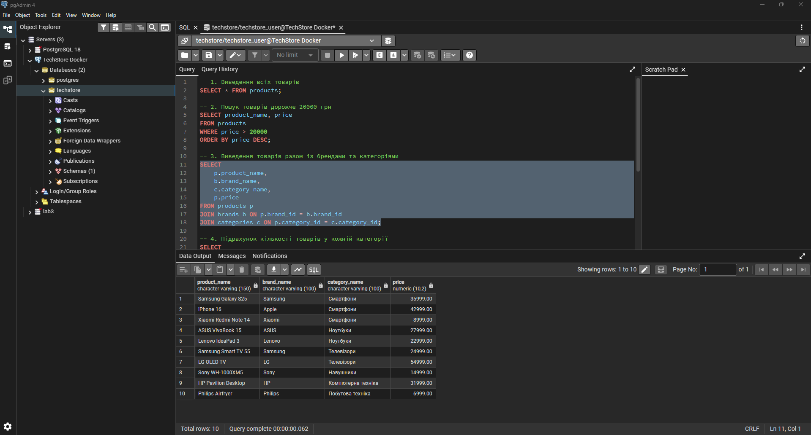
4. Підрахунок кількості товарів у кожній категорії за допомогою COUNT та GROUP BY.
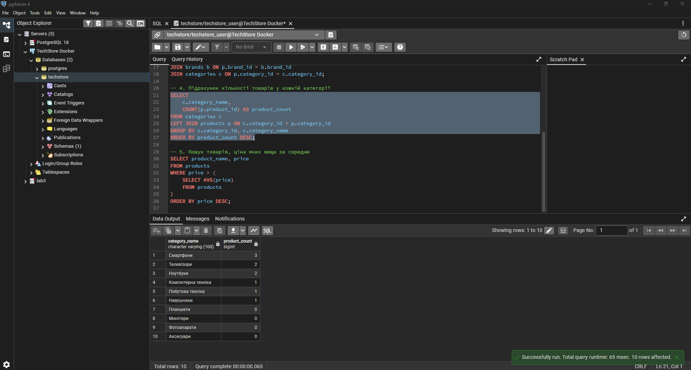
5. Пошук товарів, ціна яких перевищує середню вартість усіх товарів, за допомогою підзапиту та AVG.
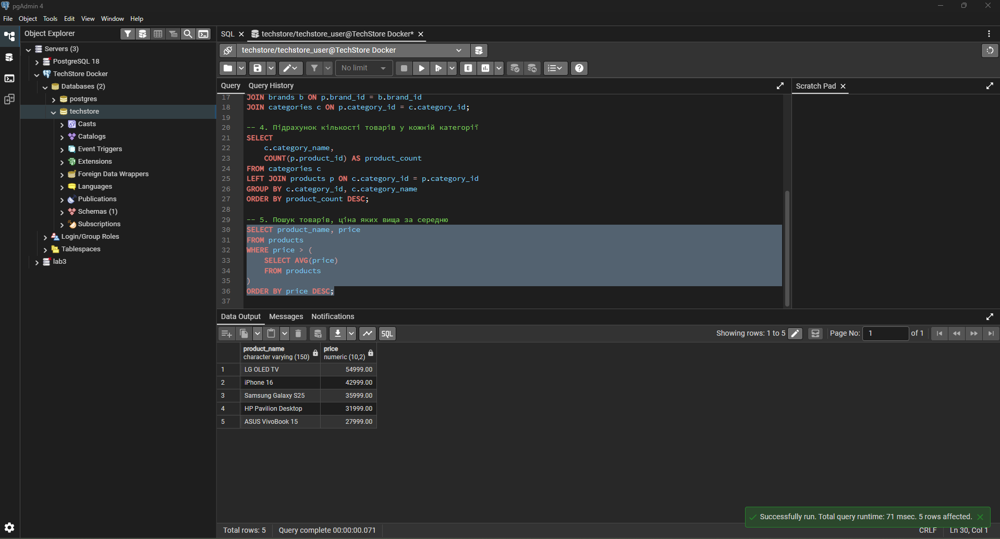

## Консольний застосунок
Було розроблено консольний застосунок мовою Python для роботи з базою даних магазину техніки.(треба psycopg2-binary(python -m pip install -r requirements.txt))
[файл застосунку](lab4-tech-store/console_app/main.py)

Для запуску програми: python console_app/main.py

Операції:
- перегляд списку товарів

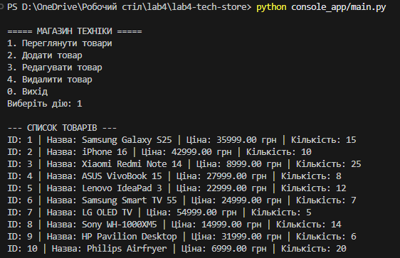
- додавання нових товарів

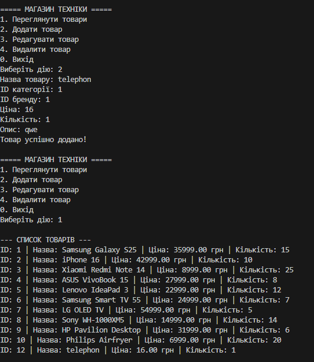
- редагування ціни та кількості товарів

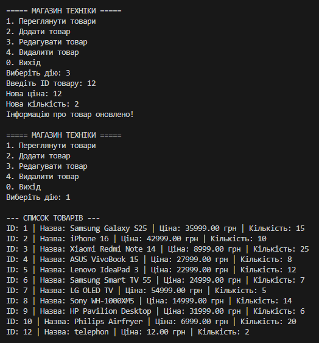
- видалення товарів

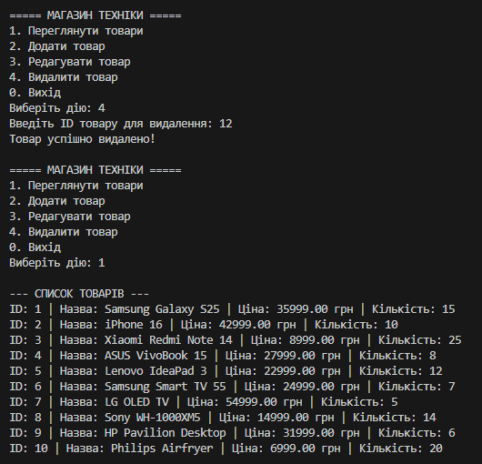
## Вебзастосунок (якщо реалізовано)
Всі файли вебзастосунку:[папка зі всіма файлами](lab4-tech-store/web_app/)

[Скріншоти інтерфейсу]

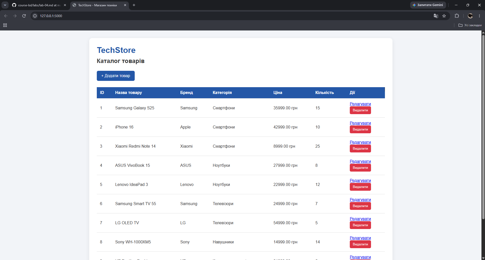
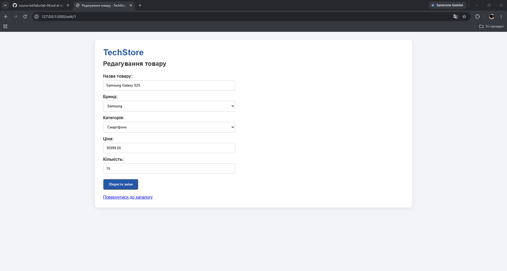

[Скріншот з докеру]

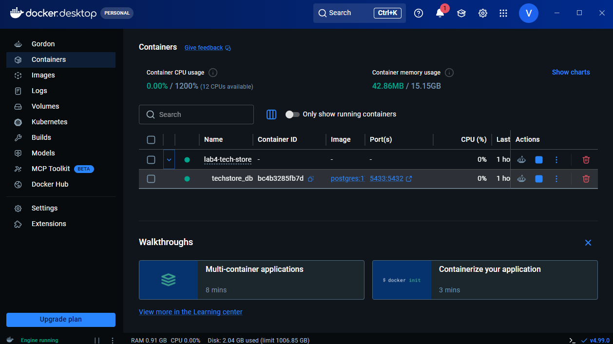

## Розширена функціональність (рівень 3, якщо реалізовано)
Для розширення можливостей бази даних було створено три функції PostgreSQL:
[файл з функціями](lab4-tech-store\database\functions.sql)

1. search_products() - пошук товарів за назвою.

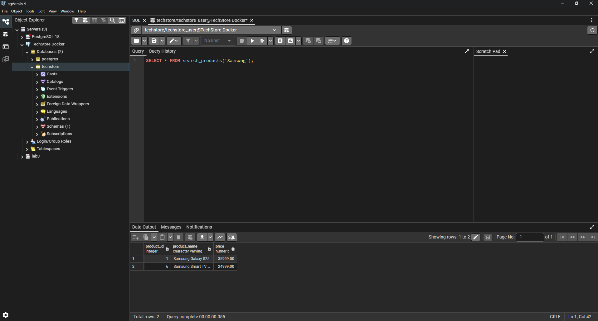
2. get_order_total() - обчислення загальної вартості замовлення.


3. get_monthly_sales() - отримання статистики продажів за місяцями.

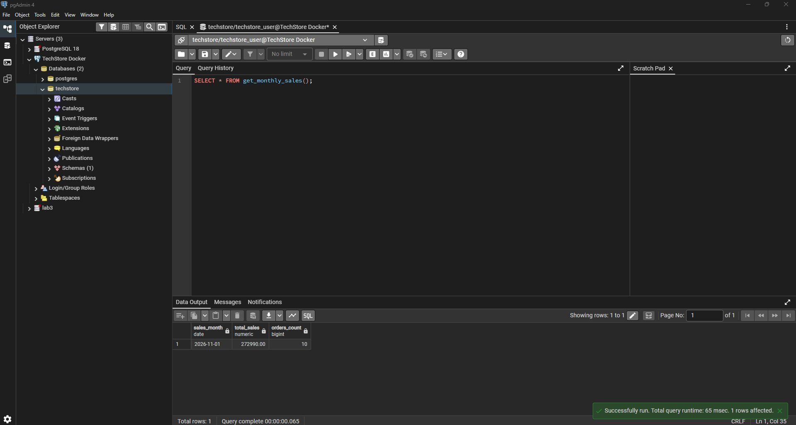


Також було реалізовано два тригери. Перший автоматично зменшує кількість товару на складі під час додавання його до замовлення. Другий перераховує загальну суму замовлення після зміни його складу.
[файл з тригерами](lab4-tech-store\database\triggers.sql)
Перевірка тригерів:
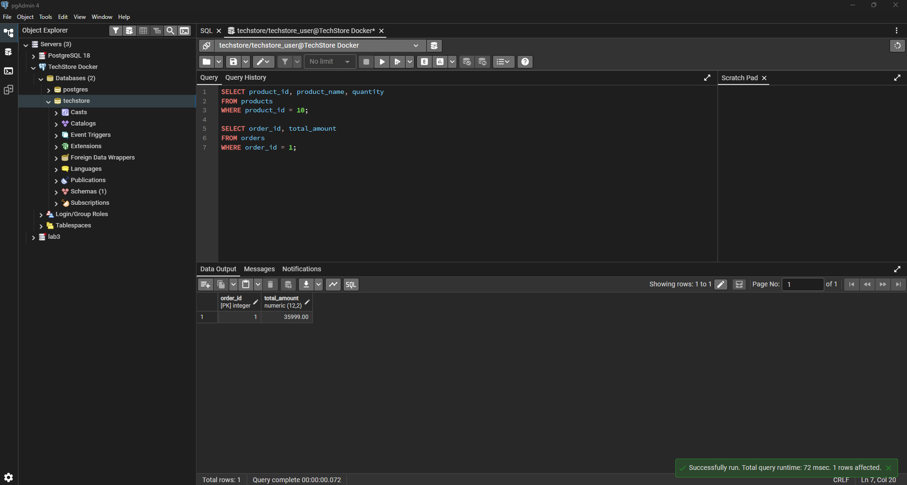
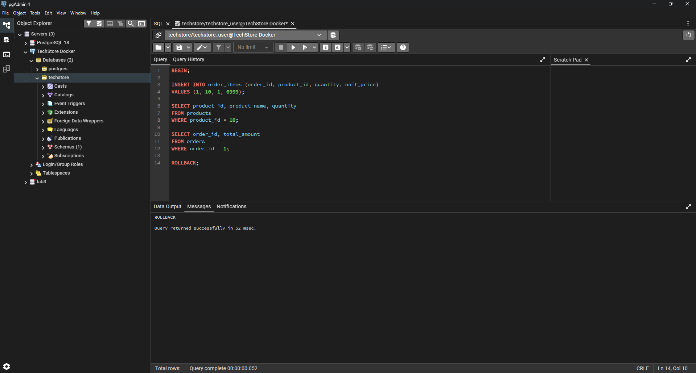


Для зручного перегляду інформації створено два представлення:

1. product_catalog - каталог товарів із назвами брендів та категорій.

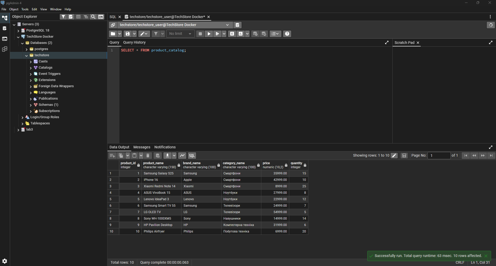
2. product_sales - інформація про кількість проданих товарів та суму продажів.

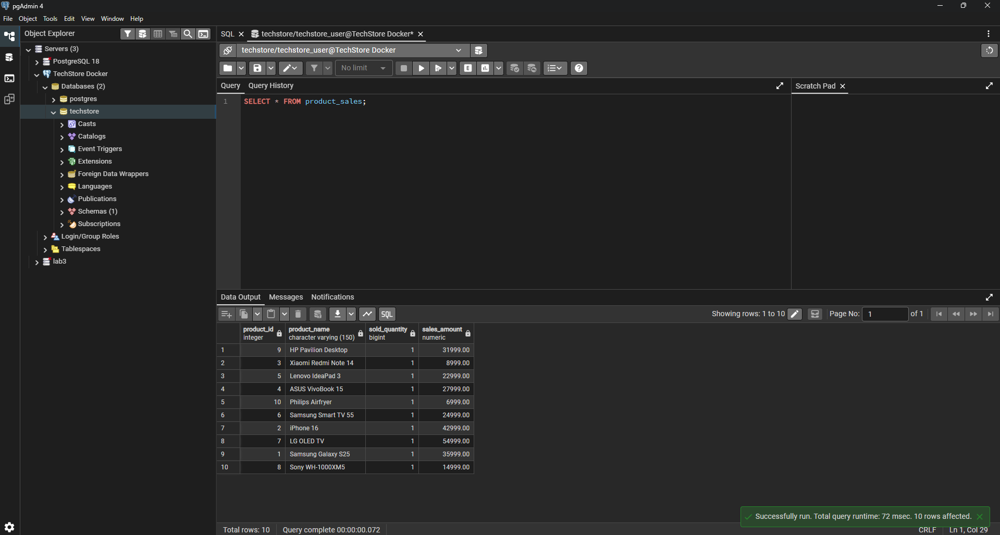
## Висновки
```
Під час виконання лабораторної роботи було розроблено базу даних магазину електроніки та побутової техніки. Створено таблиці, налаштовано зв'язки між ними, додано тестові дані, SQL-запити, функції, тригери та представлення. Також реалізовано консольний і вебзастосунок для роботи з базою даних. У результаті отримано працездатну систему для обліку товарів і замовлень. Використовував chat gpt для швидкого виконання завдань та вмісту бази даних
```