# Звіт з лабораторної роботи №7

## Загальна інформація
- ПІБ студента: Кравчук Владислав Вікторович
- Група:ІПЗ-31
- Рівень виконання:2

## 1 Рівень

### Проєктування схеми бази даних
1. Визначити структуру колекції users - користувачі та їхні ролі. [schema.md](blog-app/schema.md)
```
# Схема бази даних blog_system

## 1. Колекція users
# Схема бази даних blog_system

## 1. Колекція users

Колекція users призначена для зберігання інформації про користувачів блогу.

Структура документа:

- _id - унікальний ідентифікатор користувача (ObjectId).
- username - ім'я користувача (String).
- email - електронна пошта (String).
- password_hash - хеш пароля (String).
- role - роль користувача (String).
- profile - особиста інформація (Object).
  - first_name - ім'я (String).
  - last_name - прізвище (String).
- statistics - статистика користувача (Object).
  - posts_count - кількість створених постів (Number).
  - comments_count - кількість коментарів (Number).
- created_at - дата реєстрації (Date).
- last_login - дата останнього входу (Date).
- status - стан облікового запису (String).

Можливі ролі:
- admin - адміністратор.
- author - автор.
- reader - читач.
```
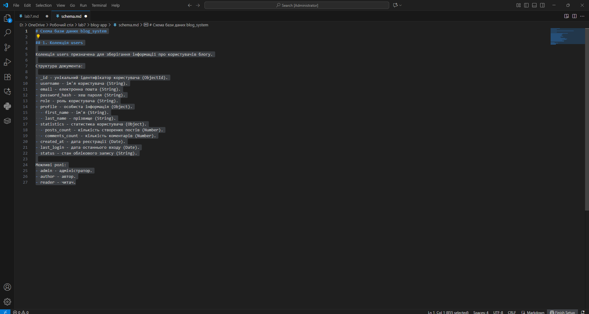

2. Визначити структуру колекції posts - статті, автори, категорії, теги, коментарі та статистика. 
```
## 2. Колекція posts

Колекція posts призначена для зберігання публікацій блогу.

Структура документа:

- _id - унікальний ідентифікатор публікації (ObjectId).
- title - назва статті (String).
- slug - URL-ідентифікатор статті (String).
- content - повний текст статті (String).
- excerpt - короткий опис статті (String).
- author - інформація про автора (Object).
  - user_id - ідентифікатор автора (ObjectId).
  - username - ім'я автора (String).
- category - інформація про категорію (Object).
  - category_id - ідентифікатор категорії (ObjectId).
  - name - назва категорії (String).
- tags - масив тегів (Array of String).
- featured_image - посилання на зображення (String).
- status - статус публікації (String).
- comments - масив коментарів (Array of Object).
  - _id - ідентифікатор коментаря (ObjectId).
  - user_id - ідентифікатор автора коментаря (ObjectId).
  - username - ім'я автора коментаря (String).
  - text - текст коментаря (String).
  - status - статус коментаря (String).
  - created_at - дата створення (Date).
- statistics - статистика публікації (Object).
  - views - кількість переглядів (Number).
  - likes - кількість лайків (Number).
  - dislikes - кількість дизлайків (Number).
  - comments_count - кількість коментарів (Number).
- created_at - дата створення (Date).
- updated_at - дата оновлення (Date).
- published_at - дата публікації (Date).

Можливі статуси публікації:
- draft - чернетка.
- published - опублікована.
- archived - архівована.
```
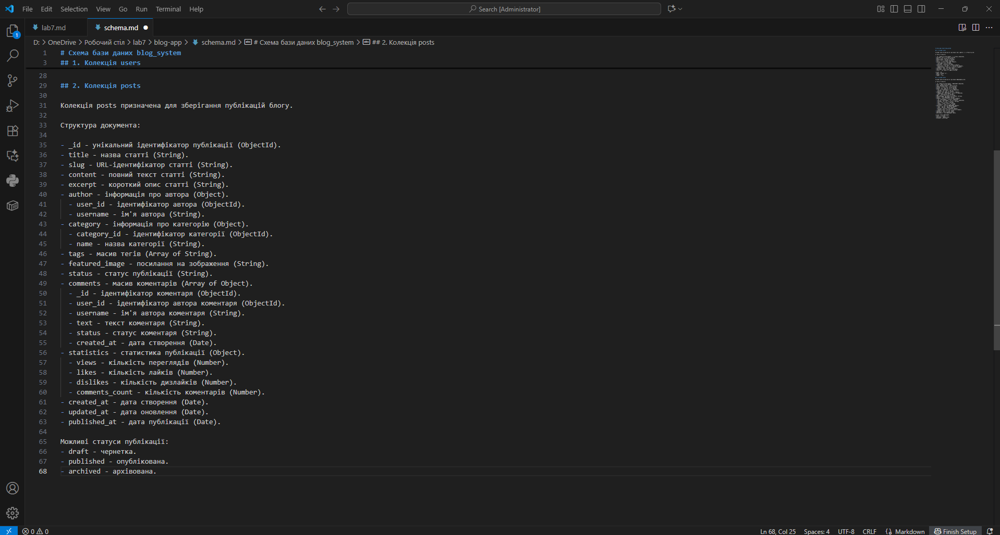

3. Визначити структуру колекції categories - категорії та їхні описи.
```
## 3. Колекція categories

Колекція categories призначена для зберігання категорій публікацій блогу.

Структура документа:

- _id - унікальний ідентифікатор категорії (ObjectId).
- name - назва категорії (String).
- slug - URL-ідентифікатор категорії (String).
- description - опис категорії (String).
- parent_id - ідентифікатор батьківської категорії (ObjectId або null).
- statistics - статистика категорії (Object).
  - posts_count - кількість публікацій у категорії (Number).
- created_at - дата створення категорії (Date).
```
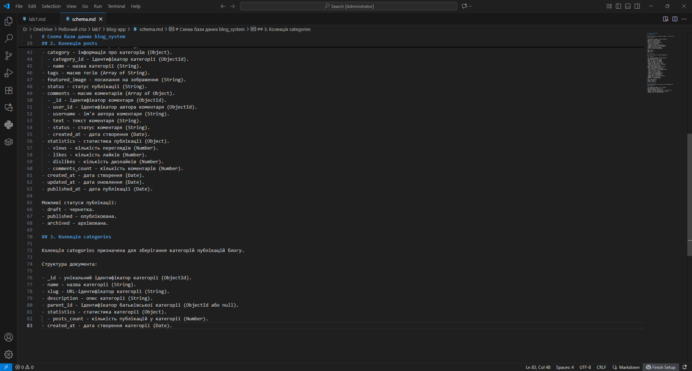

4. Визначити типи даних і зв'язки між документами.
```
## 4. Типи даних і зв'язки між документами

Для зберігання даних використовуються такі типи MongoDB:
- ObjectId - ідентифікатори документів.
- String - текстові значення.
- Number - числові значення.
- Date - дата та час.
- Boolean - логічні значення.
- Array - масиви елементів.
- Object - вкладені документи.
- null - відсутнє значення.

Зв'язки між колекціями:

1. users і posts:
Один користувач може створювати багато публікацій. У полі author документа posts зберігається user_id автора та його username.

2. categories і posts:
Одна категорія може містити багато публікацій. У полі category документа posts зберігається category_id та назва категорії.

3. posts і comments:
Одна публікація може містити багато коментарів. Коментарі зберігаються у вкладеному масиві comments документа posts.

4. users і comments:
Один користувач може залишати багато коментарів. У кожному коментарі зберігається user_id та username автора.

Для зв'язків між колекціями використовуються ObjectId, а для коментарів, статистики та профілів застосовуються вкладені документи.
```
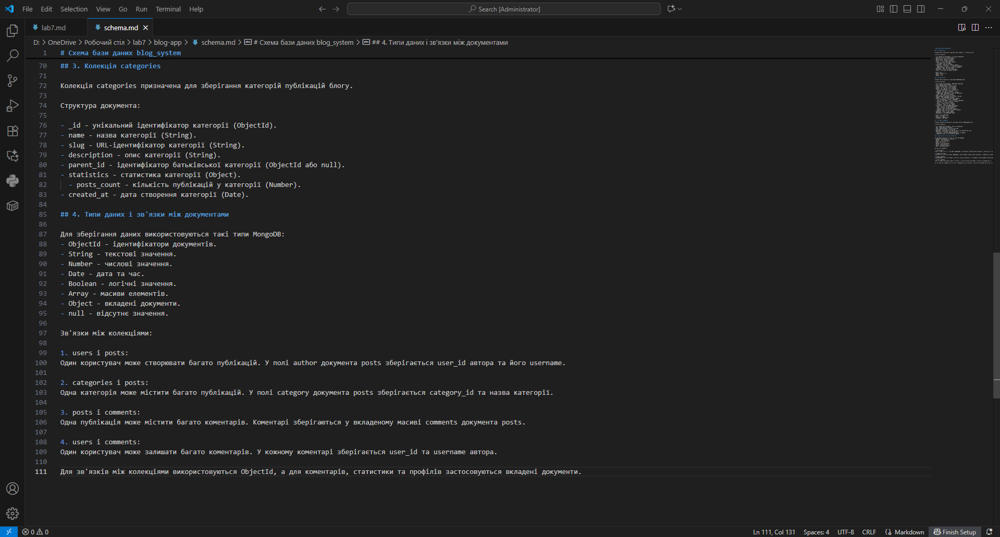


### Створення колекцій із валідацією

1. Створити базу даних blog_system.
```
& "D:\Downloads 2 disk D\mongosh-2.14.3-win32-x64\mongosh-2.14.3-win32-x64\bin\mongosh.exe"
use blog_system
```
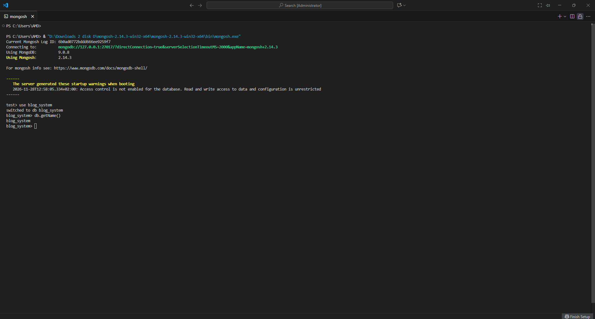

2. Створити колекцію users із перевіркою полів.
```
db.createCollection("users", {
  validator: {
    $jsonSchema: {
      bsonType: "object",
      required: [
        "username",
        "email",
        "password_hash",
        "role",
        "created_at"
      ],
      properties: {
        username: {
          bsonType: "string",
          minLength: 3,
          maxLength: 30
        },
        email: {
          bsonType: "string",
          pattern: "^[^@]+@[^@]+\\.[^@]+$"
        },
        password_hash: {
          bsonType: "string",
          minLength: 60
        },
        role: {
          enum: ["admin", "author", "reader"]
        },
        profile: {
          bsonType: "object"
        },
        statistics: {
          bsonType: "object"
        },
        created_at: {
          bsonType: "date"
        },
        last_login: {
          bsonType: "date"
        },
        status: {
          enum: ["active", "suspended", "deleted"]
        }
      }
    }
  },
  validationLevel: "strict",
  validationAction: "error"
});
```
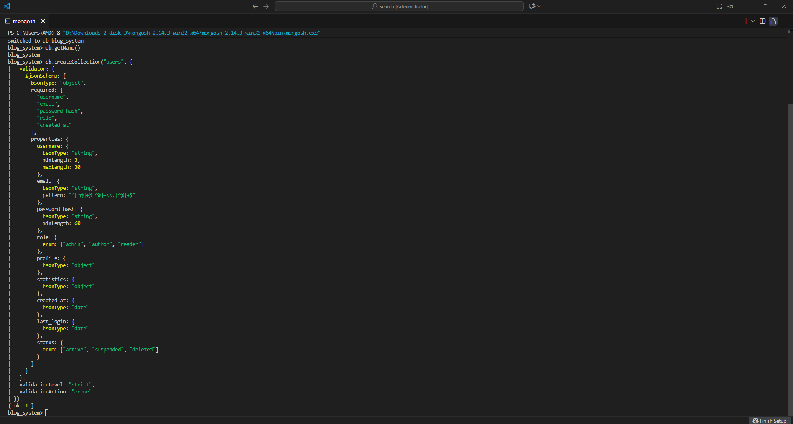

3. Створити колекцію posts із перевіркою полів.
```
db.createCollection("posts", {
  validator: {
    $jsonSchema: {
      bsonType: "object",
      required: [
        "title",
        "content",
        "author",
        "created_at",
        "status"
      ],
      properties: {
        title: {
          bsonType: "string",
          minLength: 3,
          maxLength: 200
        },
        slug: {
          bsonType: "string",
          pattern: "^[a-z0-9-]+$"
        },
        content: {
          bsonType: "string",
          minLength: 100
        },
        excerpt: {
          bsonType: "string"
        },
        author: {
          bsonType: "object",
          required: ["user_id", "username"],
          properties: {
            user_id: { bsonType: "objectId" },
            username: { bsonType: "string" }
          }
        },
        category: {
          bsonType: "object",
          properties: {
            category_id: { bsonType: "objectId" },
            name: { bsonType: "string" }
          }
        },
        tags: {
          bsonType: "array",
          items: { bsonType: "string" }
        },
        featured_image: {
          bsonType: ["string", "null"]
        },
        status: {
          bsonType: "string",
          enum: ["draft", "published", "archived"]
        },
        comments: {
          bsonType: "array",
          items: {
            bsonType: "object",
            properties: {
              user_id: { bsonType: "objectId" },
              username: { bsonType: "string" },
              text: { bsonType: "string" },
              status: {
                bsonType: "string",
                enum: ["pending", "approved", "rejected"]
              },
              created_at: { bsonType: "date" }
            }
          }
        },
        statistics: {
          bsonType: "object",
          properties: {
            views: { bsonType: "number" },
            likes: { bsonType: "number" },
            dislikes: { bsonType: "number" },
            comments_count: { bsonType: "number" }
          }
        },
        created_at: {
          bsonType: "date"
        },
        updated_at: {
          bsonType: "date"
        },
        published_at: {
          bsonType: ["date", "null"]
        }
      }
    }
  },
  validationLevel: "strict",
  validationAction: "error"
});
```
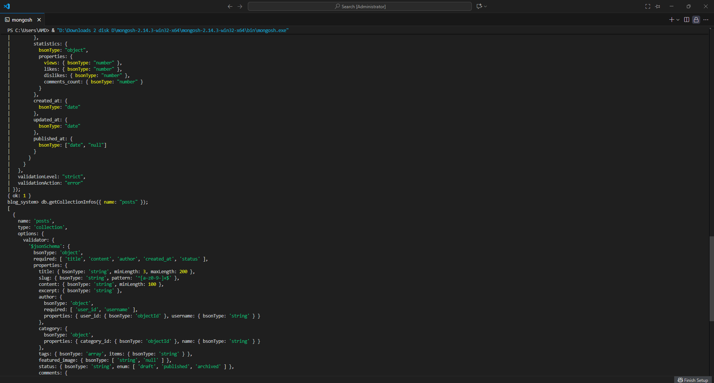

4. Створити колекцію categories із перевіркою полів.
```
db.createCollection("categories", {
  validator: {
    $jsonSchema: {
      bsonType: "object",
      required: ["name", "slug", "created_at"],
      properties: {
        name: {
          bsonType: "string",
          minLength: 2,
          maxLength: 50
        },
        slug: {
          bsonType: "string",
          pattern: "^[a-z0-9-]+$"
        },
        description: {
          bsonType: "string"
        },
        parent_id: {
          bsonType: ["objectId", "null"]
        },
        statistics: {
          bsonType: "object",
          properties: {
            posts_count: {
              bsonType: "number"
            }
          }
        },
        created_at: {
          bsonType: "date"
        }
      }
    }
  },
  validationLevel: "strict",
  validationAction: "error"
});
```
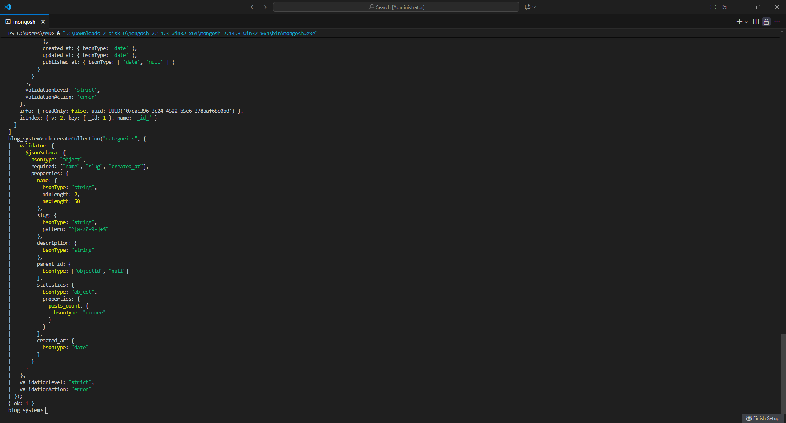


### Створення індексів

1. Створити унікальні індекси для імен користувачів та електронної пошти.
```
db.users.createIndex(
  { username: 1 },
  { unique: true }
);

db.users.createIndex(
  { email: 1 },
  { unique: true }
);
```
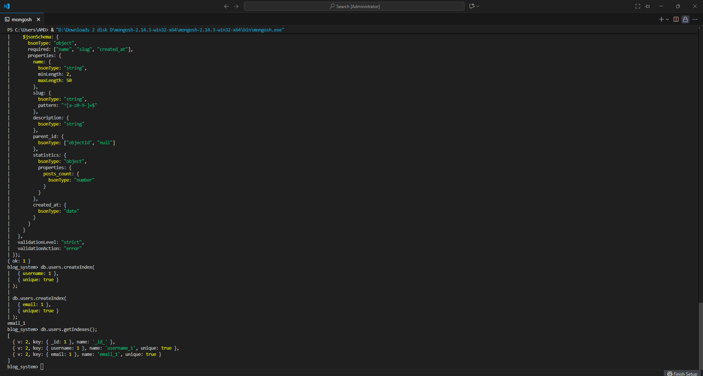
2. Створити індекс для пошуку постів за автором.
```
db.posts.createIndex({
  "author.user_id": 1,
  created_at: -1
});
```
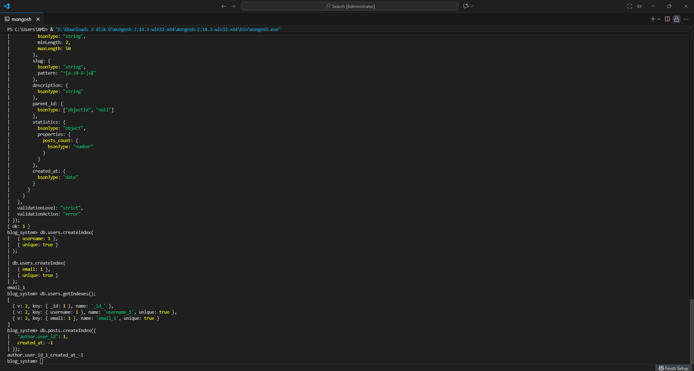

3. Створити індекс для пошуку постів за категорією.
```
db.posts.createIndex({
  "category.category_id": 1,
  status: 1
});
```
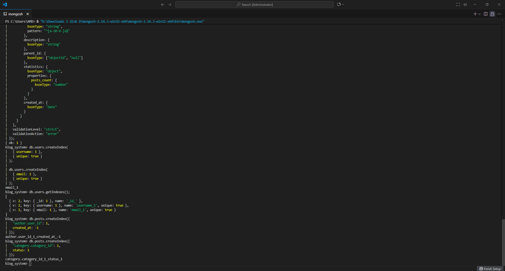

4. Створити індекс для сортування постів за датою.
```
db.posts.createIndex({
  published_at: -1
});
```
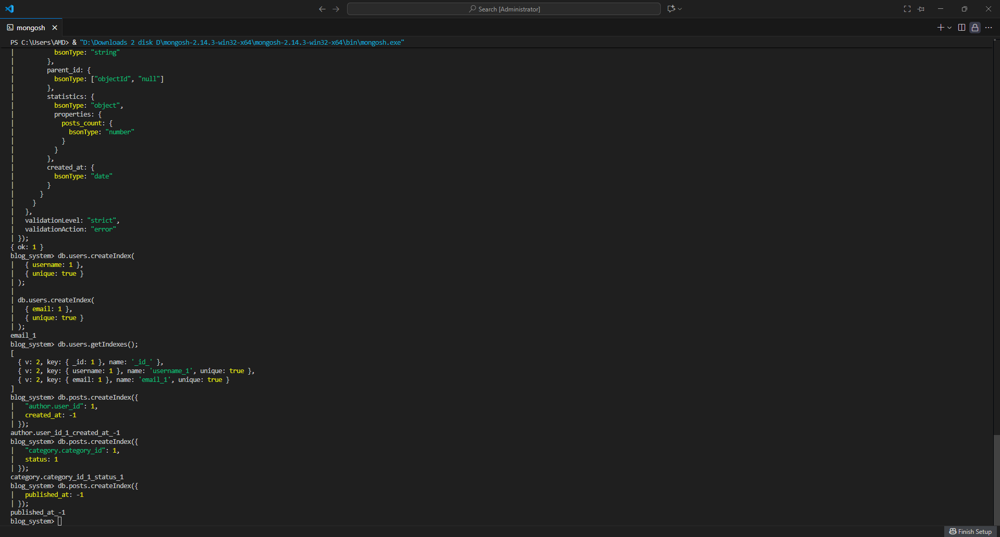

5. Створити індекс для пошуку за тегами.
```
db.posts.createIndex({
  tags: 1
});
```
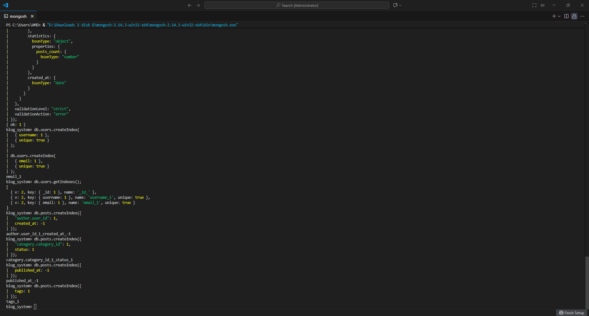

6. Створити текстовий індекс для подальшого повнотекстового пошуку.
```
db.posts.createIndex(
  {
    title: "text",
    content: "text",
    excerpt: "text"
  },
  {
    default_language: "none"
  }
);
```
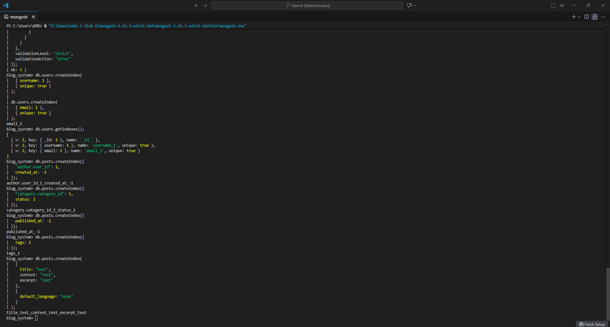


### Заповнення бази даних тестовими даними

1. Створити 20 користувачів із різними ролями. [users.js](blog-app\users.js)
```
const { MongoClient } = require("mongodb");

const uri = "mongodb://127.0.0.1:27017";
const client = new MongoClient(uri);

async function createUsers() {
    try {
        await client.connect();

        const db = client.db("blog_system");
        const users = db.collection("users");

        const userData = [];

        for (let i = 1; i <= 20; i++) {
            userData.push({
                username: `user${i}`,
                email: `user${i}@example.com`,
                password_hash: "a".repeat(60),

                role: i === 1
                    ? "admin"
                    : i <= 10
                        ? "author"
                        : "reader",

                profile: {
                    first_name: `Ім'я${i}`,
                    last_name: `Прізвище${i}`
                },

                statistics: {
                    posts_count: 0,
                    comments_count: 0
                },

                created_at: new Date(),
                last_login: new Date(),
                status: "active"
            });
        }

        const result = await users.insertMany(userData);

        console.log("Користувачів успішно створено:", result.insertedCount);

    } catch (error) {
        console.error("Помилка:", error);
    } finally {
        await client.close();
    }
}

createUsers();
```
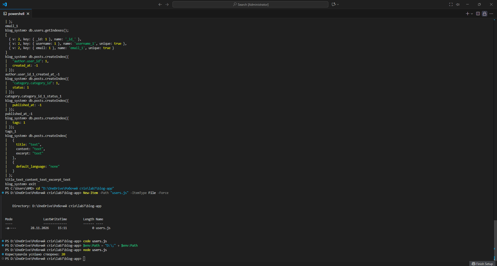

2. Створити 10 категорій. [categories.js](blog-app\categories.js)
```
const { MongoClient } = require("mongodb");

const uri = "mongodb://127.0.0.1:27017";
const client = new MongoClient(uri);

async function createCategories() {
    try {
        await client.connect();

        const db = client.db("blog_system");
        const categories = db.collection("categories");

        const names = [
            "Програмування",
            "Технології",
            "Ігри",
            "Наука",
            "Освіта",
            "Дизайн",
            "Бізнес",
            "Мобільні додатки",
            "Штучний інтелект",
            "Кібербезпека"
        ];

        const categoryData = names.map((name, index) => ({
            name: name,
            slug: `category-${index + 1}`,
            description: `Публікації на тему: ${name}`,
            parent_id: null,
            statistics: {
                posts_count: 0
            },
            created_at: new Date()
        }));

        const result = await categories.insertMany(categoryData);

        console.log("Категорій успішно створено:", result.insertedCount);

    } catch (error) {
        console.error("Помилка:", error);
    } finally {
        await client.close();
    }
}

createCategories();
```
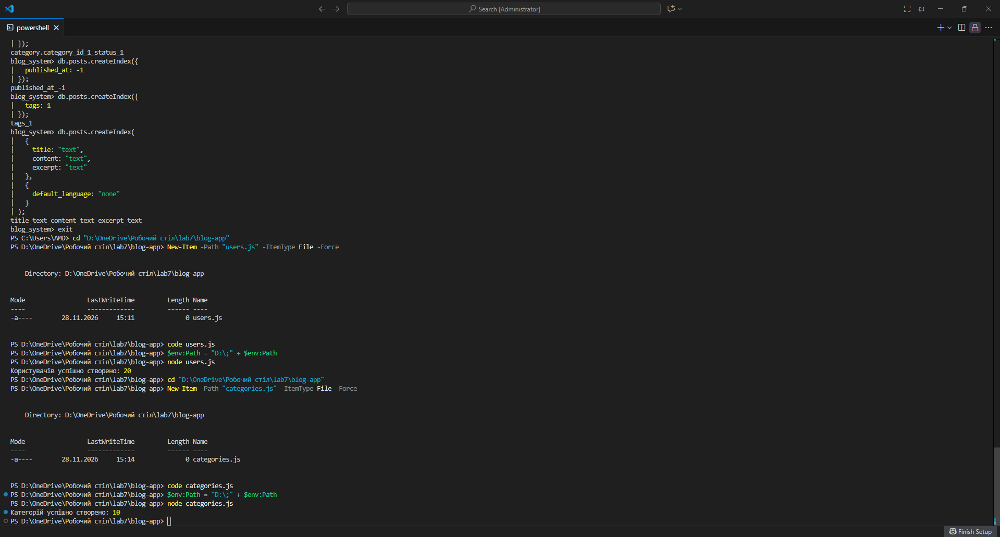

3. Створити 50 постів із різними авторами, категоріями та тегами. [posts.js](lab7\blog-app\posts.js)
```
const { MongoClient } = require("mongodb");

const uri = "mongodb://127.0.0.1:27017";
const client = new MongoClient(uri);

async function createPosts() {
    try {
        await client.connect();

        const db = client.db("blog_system");

        const users = await db.collection("users").find({
            role: { $in: ["admin", "author"] }
        }).toArray();

        const categories = await db.collection("categories")
            .find()
            .toArray();

        if (users.length === 0 || categories.length === 0) {
            throw new Error("Спочатку потрібно створити користувачів і категорії.");
        }

        const postsData = [];

        const topics = [
            "Основи програмування",
            "Сучасні технології",
            "Розробка вебзастосунків",
            "Штучний інтелект",
            "Інформаційна безпека",
            "Комп'ютерні ігри",
            "Мобільні технології",
            "Основи дизайну",
            "Навчання програмуванню",
            "Розвиток цифрового світу"
        ];

        for (let i = 0; i < 50; i++) {
            const author = users[i % users.length];
            const category = categories[i % categories.length];
            const topic = topics[i % topics.length];

            const content =
                `${topic}. У цій публікації розглядаються основні поняття та практичні особливості цієї теми. ` +
                "Матеріал допомагає краще зрозуміти сучасні інформаційні технології, їх використання та можливості. " +
                "Також наведено корисні рекомендації для початківців і приклади застосування отриманих знань.";

            const createdAt = new Date();

            postsData.push({
                title: `${topic} - стаття №${i + 1}`,
                slug: `post-${i + 1}`,
                content: content,
                excerpt: `Короткий опис публікації №${i + 1}.`,

                author: {
                    user_id: author._id,
                    username: author.username
                },

                category: {
                    category_id: category._id,
                    name: category.name
                },

                tags: [
                    `tag-${(i % 5) + 1}`,
                    `topic-${(i % 3) + 1}`
                ],

                featured_image: null,
                status: "published",
                comments: [],

                statistics: {
                    views: 0,
                    likes: 0,
                    dislikes: 0,
                    comments_count: 0
                },

                created_at: createdAt,
                updated_at: createdAt,
                published_at: createdAt
            });
        }

        const result = await db.collection("posts").insertMany(postsData);

        console.log("Публікацій успішно створено:", result.insertedCount);

    } catch (error) {
        console.error("Помилка:", error);
    } finally {
        await client.close();
    }
}

createPosts();
```
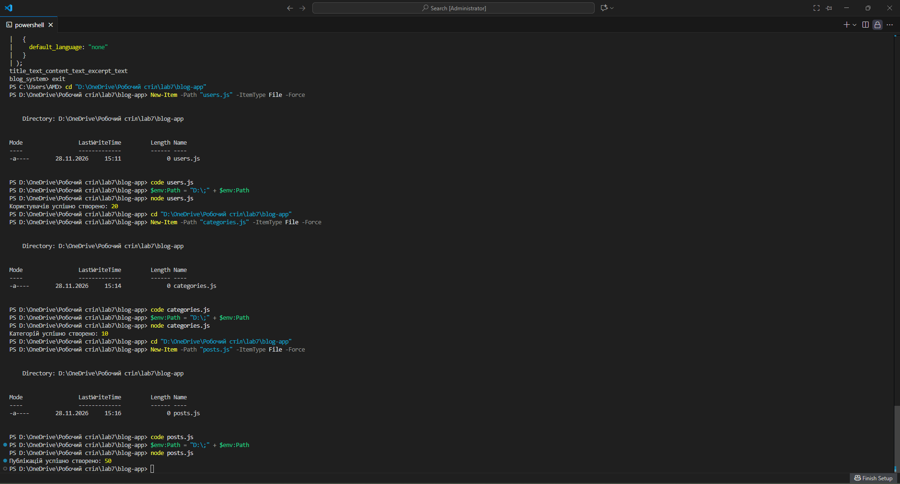

4. Додати до постів щонайменше 200 коментарів. [comments.js](lab7\blog-app\comments.js)
```
const { MongoClient, ObjectId } = require("mongodb");

const uri = "mongodb://127.0.0.1:27017";
const client = new MongoClient(uri);

async function createComments() {
    try {
        await client.connect();

        const db = client.db("blog_system");

        const users = await db.collection("users")
            .find()
            .toArray();

        const posts = await db.collection("posts")
            .find()
            .toArray();

        if (users.length === 0 || posts.length === 0) {
            throw new Error("Не знайдено користувачів або публікацій.");
        }

        let totalComments = 0;

        for (const post of posts) {
            const comments = [];

            for (let i = 0; i < 4; i++) {
                const user = users[(totalComments + i) % users.length];

                comments.push({
                    _id: new ObjectId(),
                    user_id: user._id,
                    username: user.username,
                    text: `Тестовий коментар №${totalComments + i + 1} до публікації "${post.title}".`,
                    status: "approved",
                    created_at: new Date()
                });
            }

            await db.collection("posts").updateOne(
                { _id: post._id },
                { $push: { comments: { $each: comments } } }
            );

            totalComments += 4;
        }

        console.log("Коментарів успішно створено:", totalComments);

    } catch (error) {
        console.error("Помилка:", error);
    } finally {
        await client.close();
    }
}

createComments();
```
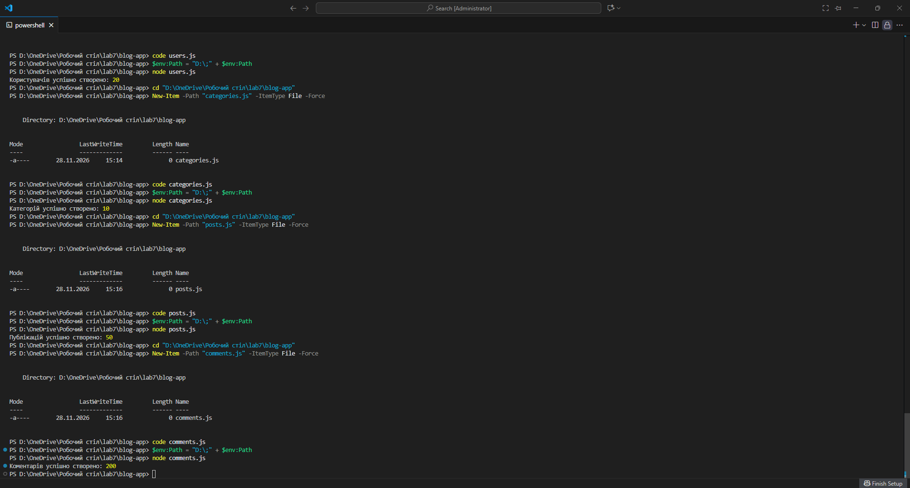

5. Заповнити статистику постів: перегляди, лайки та кількість коментарів. [statistics.js](blog-app\statistics.js)
```
const { MongoClient } = require("mongodb");

const uri = "mongodb://127.0.0.1:27017";
const client = new MongoClient(uri);

async function updateStatistics() {
    try {
        await client.connect();

        const db = client.db("blog_system");
        const posts = db.collection("posts");

        const allPosts = await posts.find().toArray();

        for (let i = 0; i < allPosts.length; i++) {
            const post = allPosts[i];

            await posts.updateOne(
                { _id: post._id },
                {
                    $set: {
                        "statistics.views": (i + 1) * 15,
                        "statistics.likes": (i + 1) * 3,
                        "statistics.dislikes": i + 1,
                        "statistics.comments_count": post.comments.length
                    }
                }
            );
        }

        console.log("Статистику оновлено для публікацій:", allPosts.length);

    } catch (error) {
        console.error("Помилка:", error);
    } finally {
        await client.close();
    }
}

updateStatistics();
```
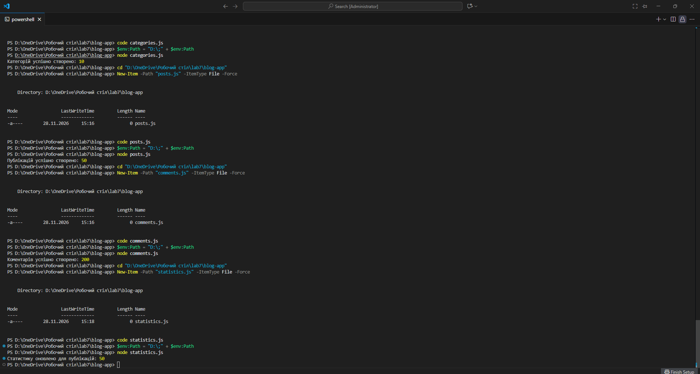

### Розробка агрегаційних запитів

1. Визначити топ-10 авторів за кількістю постів.
```
db.posts.aggregate([
    {
        $group: {
            _id: "$author.username",
            posts_count: { $sum: 1 }
        }
    },
    {
        $sort: { posts_count: -1 }
    },
    {
        $limit: 10
    },
    {
        $project: {
            _id: 0,
            author: "$_id",
            posts_count: 1
        }
    }
]);
```
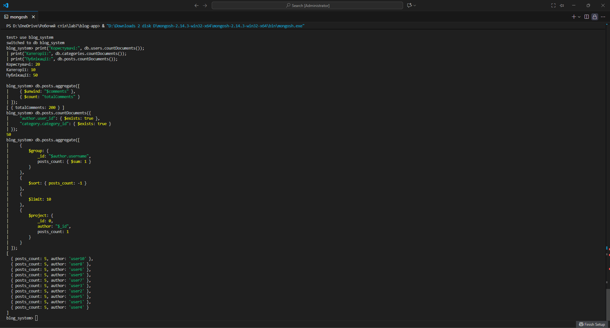

2. Визначити популярні категорії за кількістю постів.
```
db.posts.aggregate([
    {
        $group: {
            _id: "$category.name",
            posts_count: { $sum: 1 }
        }
    },
    {
        $sort: {
            posts_count: -1
        }
    },
    {
        $project: {
            _id: 0,
            category: "$_id",
            posts_count: 1
        }
    }
]);
```
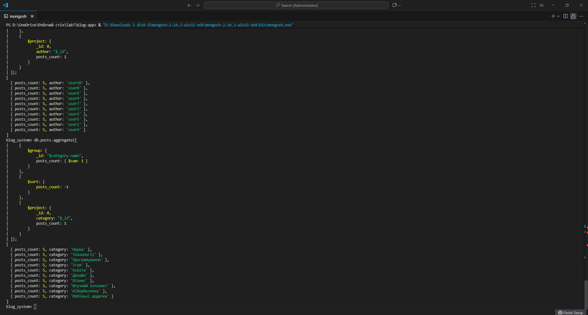

3. Отримати загальну кількість коментарів.
```
db.posts.aggregate([
    {
        $unwind: "$comments"
    },
    {
        $count: "total_comments"
    }
]);
```
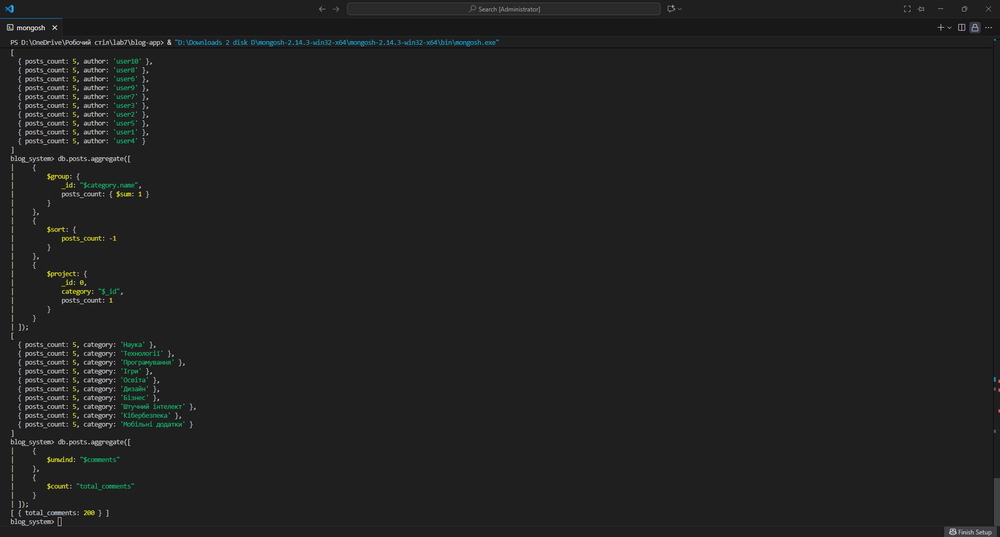

4. Обчислити середню кількість коментарів на один пост.
```
db.posts.aggregate([
    {
        $project: {
            comments_count: {
                $size: "$comments"
            }
        }
    },
    {
        $group: {
            _id: null,
            average_comments: {
                $avg: "$comments_count"
            }
        }
    },
    {
        $project: {
            _id: 0,
            average_comments: 1
        }
    }
]);
```
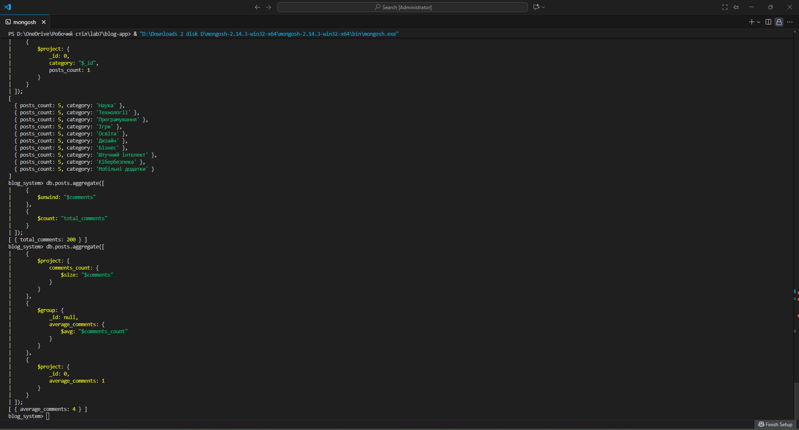

5. Визначити популярні теги.
```
db.posts.aggregate([
    {
        $unwind: "$tags"
    },
    {
        $group: {
            _id: "$tags",
            usage_count: { $sum: 1 }
        }
    },
    {
        $sort: {
            usage_count: -1
        }
    },
    {
        $limit: 10
    },
    {
        $project: {
            _id: 0,
            tag: "$_id",
            usage_count: 1
        }
    }
]);
```
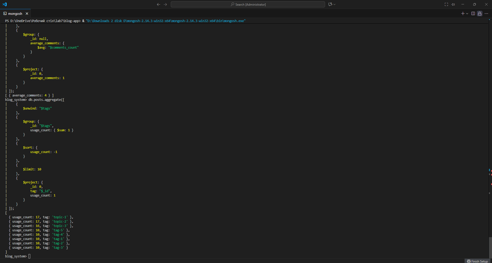

### Створення вебінтерфейсу

1. Створити Node.js-проєкт.
```
Test-Path "package.json"
npm init -y
$env:Path = "D:\;" + $env:Path
npm install express mongodb

для структури проєкту
New-Item -ItemType Directory -Force -Path "public"
New-Item -ItemType File -Force -Path "server.js"
New-Item -ItemType File -Force -Path "public\index.html"
```
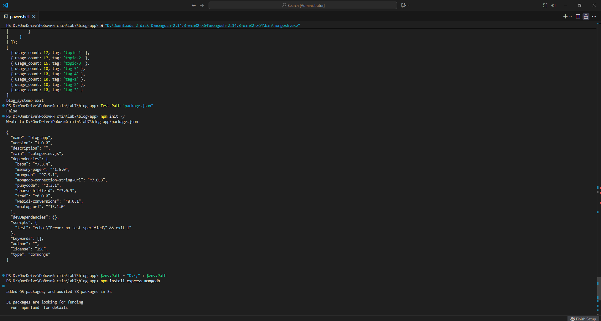

2. Створити сервер server.js і підключити його до MongoDB. [server.js](blog-app\statistics.js)
```
const express = require("express");
const { MongoClient, ObjectId } = require("mongodb");

const app = express();
const PORT = 3000;

const uri = "mongodb://127.0.0.1:27017";
const client = new MongoClient(uri);

app.use(express.json());
app.use(express.static("public"));

let db;

async function startServer() {
    try {
        await client.connect();

        db = client.db("blog_system");

        console.log("Підключено до MongoDB");

        app.listen(PORT, () => {
            console.log(`Сервер запущено: http://localhost:${PORT}`);
        });

    } catch (error) {
        console.error("Помилка підключення:", error);
        process.exit(1);
    }
}

// Отримання списку публікацій
app.get("/api/posts", async (req, res) => {
    try {
        const posts = await db.collection("posts")
            .find({ status: "published" })
            .sort({ published_at: -1 })
            .toArray();

        res.json(posts);

    } catch (error) {
        res.status(500).json({ error: "Не вдалося отримати публікації" });
    }
});

// Отримання однієї публікації
app.get("/api/posts/:id", async (req, res) => {
    try {
        if (!ObjectId.isValid(req.params.id)) {
            return res.status(400).json({ error: "Некоректний ID" });
        }

        const post = await db.collection("posts").findOne({
            _id: new ObjectId(req.params.id),
            status: "published"
        });

        if (!post) {
            return res.status(404).json({ error: "Публікацію не знайдено" });
        }

        res.json(post);

    } catch (error) {
        res.status(500).json({ error: "Помилка отримання публікації" });
    }
});

startServer();
```
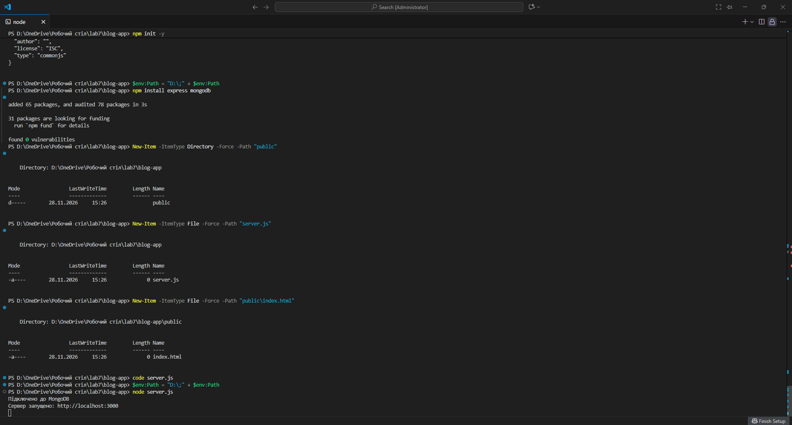

3. Створити HTML-сторінку для відображення постів. [index.html](blog-app\public\index.html)
```
<!DOCTYPE html>
<html lang="uk">
<head>
    <meta charset="UTF-8">
    <meta name="viewport" content="width=device-width, initial-scale=1.0">
    <title>Blog System</title>

    <style>
        * {
            box-sizing: border-box;
        }

        body {
            margin: 0;
            font-family: Arial, sans-serif;
            background: #f3f4f6;
            color: #222;
        }

        header {
            background: #252b38;
            color: white;
            padding: 25px;
            text-align: center;
        }

        main {
            max-width: 1100px;
            margin: 30px auto;
            padding: 0 20px;
        }

        #posts {
            display: grid;
            grid-template-columns: repeat(auto-fit, minmax(260px, 1fr));
            gap: 20px;
        }

        .post {
            background: white;
            padding: 20px;
            border-radius: 10px;
            box-shadow: 0 2px 8px #00000015;
        }

        .post h2 {
            margin-top: 0;
            color: #2563eb;
        }

        .post button {
            padding: 10px 15px;
            border: none;
            border-radius: 5px;
            background: #2563eb;
            color: white;
            cursor: pointer;
        }

        .post button:hover {
            background: #1d4ed8;
        }

        .meta {
            color: #666;
            font-size: 14px;
        }
    </style>
</head>

<body>

<header>
    <h1>Мій блог</h1>
    <p>Публікації про технології та програмування</p>
</header>

<main>
    <h2>Останні публікації</h2>
    <div id="posts">Завантаження публікацій...</div>
</main>

<script>
    async function loadPosts() {
        const container = document.getElementById("posts");

        try {
            const response = await fetch("/api/posts");

            if (!response.ok) {
                throw new Error("Не вдалося отримати публікації");
            }

            const posts = await response.json();

            container.innerHTML = "";

            posts.forEach(post => {
                const card = document.createElement("article");
                card.className = "post";

                const title = document.createElement("h2");
                title.textContent = post.title;

                const excerpt = document.createElement("p");
                excerpt.textContent = post.excerpt;

                const author = document.createElement("p");
                author.className = "meta";
                author.textContent = "Автор: " + post.author.username;

                const category = document.createElement("p");
                category.className = "meta";
                category.textContent = "Категорія: " + post.category.name;

                const button = document.createElement("button");
                button.textContent = "Читати далі";
                button.addEventListener("click", () => {
                    window.location.href = `/post.html?id=${post._id}`;
                });

                card.append(title, excerpt, author, category, button);
                container.appendChild(card);
            });

        } catch (error) {
            container.textContent = "Помилка завантаження публікацій.";
            console.error(error);
        }
    }

    loadPosts();
</script>

</body>
</html>
```
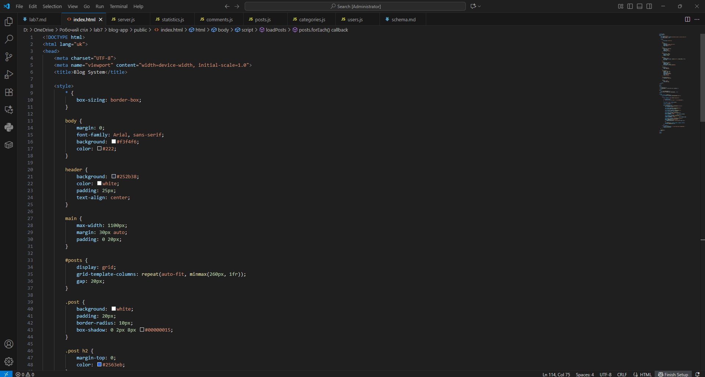
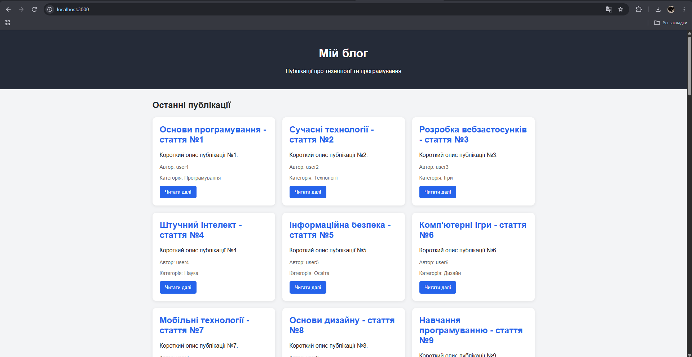

4. Реалізувати перегляд повної інформації про пост, включно з коментарями. [post.html](blog-app\public\post.html)
```
<!DOCTYPE html>
<html lang="uk">
<head>
    <meta charset="UTF-8">
    <meta name="viewport" content="width=device-width, initial-scale=1.0">
    <title>Публікація - Мій блог</title>

    <style>
        body {
            font-family: Arial, sans-serif;
            background: #f3f4f6;
            color: #222;
            margin: 0;
        }

        header {
            background: #252b38;
            color: white;
            padding: 20px;
            text-align: center;
        }

        main {
            max-width: 850px;
            margin: 30px auto;
            padding: 25px;
            background: white;
            border-radius: 10px;
        }

        .meta {
            color: #666;
            font-size: 14px;
        }

        .content {
            line-height: 1.7;
            white-space: pre-wrap;
        }

        .comment {
            background: #f3f4f6;
            padding: 15px;
            margin: 12px 0;
            border-radius: 7px;
        }

        button {
            padding: 10px 15px;
            background: #2563eb;
            color: white;
            border: none;
            border-radius: 5px;
            cursor: pointer;
        }
    </style>
</head>

<body>

<header>
    <h1>Мій блог</h1>
</header>

<main>
    <button onclick="location.href='/'">На головну</button>

    <article id="post">
        Завантаження публікації...
    </article>

    <section>
        <h2>Коментарі</h2>
        <div id="comments"></div>
    </section>
</main>

<script>
    async function loadPost() {
        const postContainer = document.getElementById("post");
        const commentsContainer = document.getElementById("comments");

        const postId = new URLSearchParams(location.search).get("id");

        if (!postId) {
            postContainer.textContent = "Не вказано ID публікації.";
            return;
        }

        try {
            const response = await fetch(`/api/posts/${postId}`);

            if (!response.ok) {
                throw new Error("Публікацію не знайдено");
            }

            const post = await response.json();

            postContainer.innerHTML = "";

            const title = document.createElement("h1");
            title.textContent = post.title;

            const author = document.createElement("p");
            author.className = "meta";
            author.textContent = "Автор: " + post.author.username;

            const category = document.createElement("p");
            category.className = "meta";
            category.textContent = "Категорія: " + post.category.name;

            const content = document.createElement("p");
            content.className = "content";
            content.textContent = post.content;

            postContainer.append(title, author, category, content);

            commentsContainer.innerHTML = "";

            const approvedComments = (post.comments || [])
                .filter(comment => comment.status === "approved");

            if (approvedComments.length === 0) {
                commentsContainer.textContent = "Коментарів поки немає.";
            } else {
                approvedComments.forEach(comment => {
                    const element = document.createElement("div");
                    element.className = "comment";

                    const username = document.createElement("strong");
                    username.textContent = comment.username;

                    const text = document.createElement("p");
                    text.textContent = comment.text;

                    element.append(username, text);
                    commentsContainer.appendChild(element);
                });
            }

        } catch (error) {
            postContainer.textContent = "Помилка завантаження публікації.";
            console.error(error);
        }
    }

    loadPost();
</script>

</body>
</html>
```
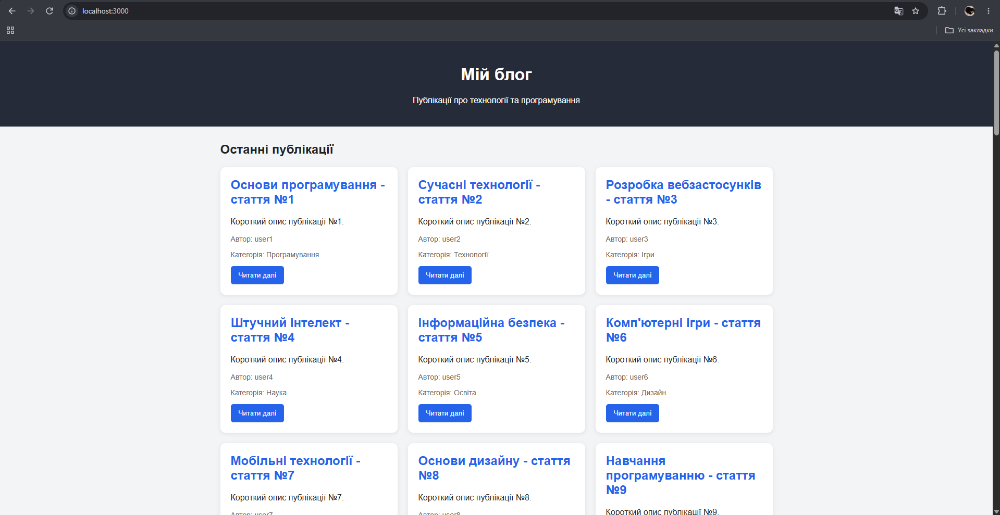

5. Додавання статистики на сторінку публікації [post.html](blog-app\public\post.html)
```
stats.className = "meta";
stats.textContent =
    `Перегляди: ${post.statistics.views} | ` +
    `Вподобання: ${post.statistics.likes} | ` +
    `Дизлайки: ${post.statistics.dislikes} | ` +
    `Коментарі: ${post.statistics.comments_count}`;

postContainer.append(title, author, category, stats, content);
```
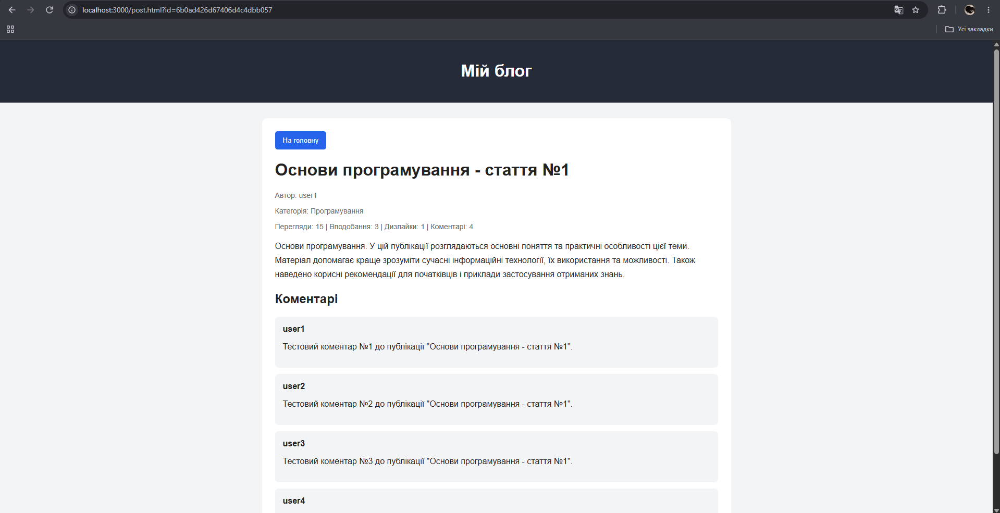


## 2 Рівень

### Система тегів та пошук

1. Реалізувати пошук постів за кількома тегами. [server.js](blog-app\server.js)
```
// Пошук публікацій за декількома тегами
app.get("/api/posts/tags", async (req, res) => {
    try {
        const tags = (req.query.tags || "")
            .split(",")
            .map(tag => tag.trim().toLowerCase())
            .filter(tag => tag.length > 0);

        if (tags.length === 0) {
            return res.status(400).json({
                error: "Вкажіть хоча б один тег"
            });
        }

        const posts = await db.collection("posts")
            .find({
                status: "published",
                tags: { $all: tags }
            })
            .sort({ published_at: -1 })
            .toArray();

        res.json(posts);

    } catch (error) {
        res.status(500).json({
            error: "Помилка пошуку за тегами"
        });
    }
});
```
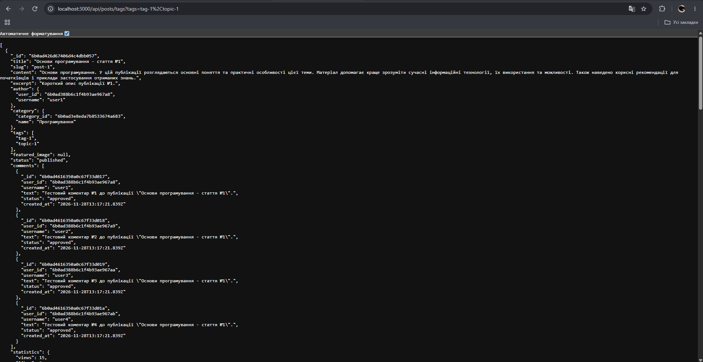

2. Пошук публікацій за автором. [server.js](blog-app\server.js)
```
// Пошук публікацій за автором
app.get("/api/posts/author/:username", async (req, res) => {
    try {
        const username = req.params.username;

        const posts = await db.collection("posts")
            .find({
                "author.username": username,
                status: "published"
            })
            .sort({ published_at: -1 })
            .toArray();

        res.json(posts);

    } catch (error) {
        res.status(500).json({
            error: "Помилка пошуку публікацій автора"
        });
    }
});
```
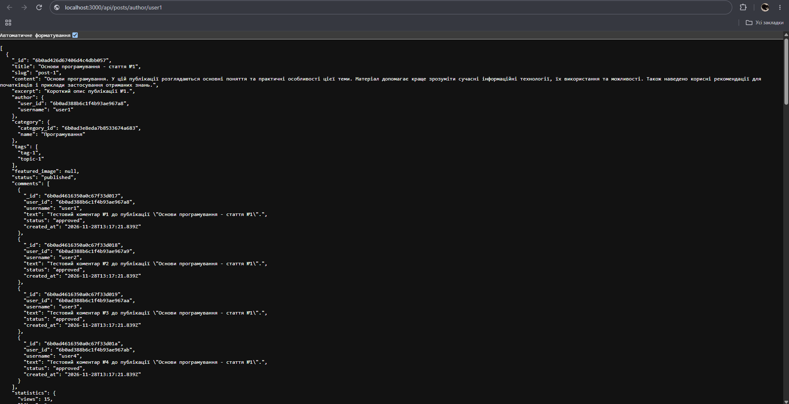

3. Фільтрація постів за тегами у вебінтерфейсі [index.html](blog-app\public\index.html)
```
style
.filter {
    display: flex;
    gap: 10px;
    margin-bottom: 20px;
    flex-wrap: wrap;
}

.filter input {
    flex: 1;
    min-width: 250px;
    padding: 10px;
    border: 1px solid #ccc;
    border-radius: 5px;
}

.filter button {
    padding: 10px 15px;
    border: none;
    border-radius: 5px;
    background: #2563eb;
    color: white;
    cursor: pointer;
}

.filter button:hover {
    background: #1d4ed8;
}

script
async function filterPosts() {
    const input = document.getElementById("tagInput");
    const tags = input.value.trim();

    if (!tags) {
        loadPosts();
        return;
    }

    const container = document.getElementById("posts");

    try {
        const response = await fetch(
            `/api/posts/tags?tags=${encodeURIComponent(tags)}`
        );

        if (!response.ok) {
            throw new Error("Помилка пошуку за тегами");
        }

        const posts = await response.json();

        container.innerHTML = "";

        if (posts.length === 0) {
            container.textContent = "Публікацій із такими тегами не знайдено.";
            return;
        }

        posts.forEach(post => {
            const card = document.createElement("article");
            card.className = "post";

            const title = document.createElement("h2");
            title.textContent = post.title;

            const excerpt = document.createElement("p");
            excerpt.textContent = post.excerpt;

            const author = document.createElement("p");
            author.className = "meta";
            author.textContent = "Автор: " + post.author.username;

            const category = document.createElement("p");
            category.className = "meta";
            category.textContent = "Категорія: " + post.category.name;

            const button = document.createElement("button");
            button.textContent = "Читати далі";
            button.addEventListener("click", () => {
                window.location.href = `/post.html?id=${post._id}`;
            });

            card.append(title, excerpt, author, category, button);
            container.appendChild(card);
        });

    } catch (error) {
        container.textContent = "Помилка фільтрації публікацій.";
        console.error(error);
    }
}
```
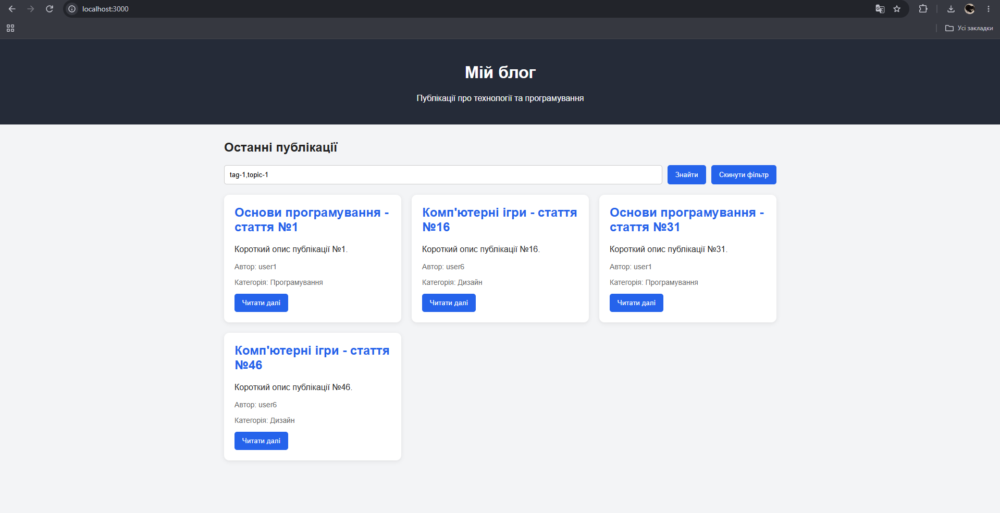

### Повнотекстовий пошук

1. Використати текстовий індекс MongoDB.
```
db.posts.getIndexes().filter(index =>
    Object.values(index.key).includes("text")
)
```
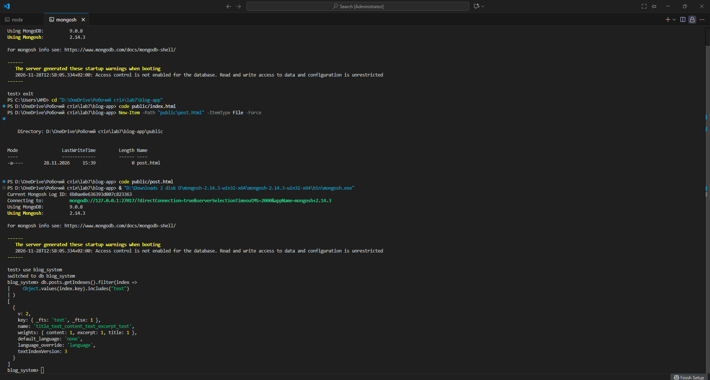

2. Реалізувати пошук за назвою та змістом постів. [server.js](blog-app\server.js)
```
// Повнотекстовий пошук публікацій
app.get("/api/posts/search", async (req, res) => {
    try {
        const searchText = (req.query.q || "").trim();

        if (!searchText) {
            return res.status(400).json({
                error: "Введіть текст для пошуку"
            });
        }

        const posts = await db.collection("posts")
            .find(
                {
                    status: "published",
                    $text: {
                        $search: searchText
                    }
                },
                {
                    projection: {
                        score: {
                            $meta: "textScore"
                        }
                    }
                }
            )
            .sort({
                score: {
                    $meta: "textScore"
                }
            })
            .toArray();

        res.json(posts);

    } catch (error) {
        console.error(error);

        res.status(500).json({
            error: "Помилка повнотекстового пошуку"
        });
    }
});
```


3. Додати поле пошуку на вебсторінку. [index.html](blog-app\public\index.html)
```
<div class="filter">
    <input
        type="text"
        id="searchInput"
        placeholder="Введіть назву або текст публікації..."
    >

    <button onclick="searchPosts()">Пошук</button>
    <button onclick="loadPosts()">Скинути</button>
</div>

async function searchPosts() {
    const input = document.getElementById("searchInput");
    const searchText = input.value.trim();

    if (!searchText) {
        loadPosts();
        return;
    }

    const container = document.getElementById("posts");

    try {
        const response = await fetch(
            `/api/posts/search?q=${encodeURIComponent(searchText)}`
        );

        if (!response.ok) {
            throw new Error("Помилка пошуку");
        }

        const posts = await response.json();

        container.innerHTML = "";

        if (posts.length === 0) {
            container.textContent = "Публікацій за вашим запитом не знайдено.";
            return;
        }

        posts.forEach(post => {
            const card = document.createElement("article");
            card.className = "post";

            const title = document.createElement("h2");
            title.textContent = post.title;

            const excerpt = document.createElement("p");
            excerpt.textContent = post.excerpt;

            const author = document.createElement("p");
            author.className = "meta";
            author.textContent = "Автор: " + post.author.username;

            const category = document.createElement("p");
            category.className = "meta";
            category.textContent = "Категорія: " + post.category.name;

            const button = document.createElement("button");
            button.textContent = "Читати далі";

            button.addEventListener("click", () => {
                window.location.href = `/post.html?id=${post._id}`;
            });

            card.append(title, excerpt, author, category, button);
            container.appendChild(card);
        });

    } catch (error) {
        container.textContent = "Помилка пошуку публікацій.";
        console.error(error);
    }
}

document.getElementById("searchInput").addEventListener("keydown", event => {
    if (event.key === "Enter") {
        searchPosts();
    }
});
```
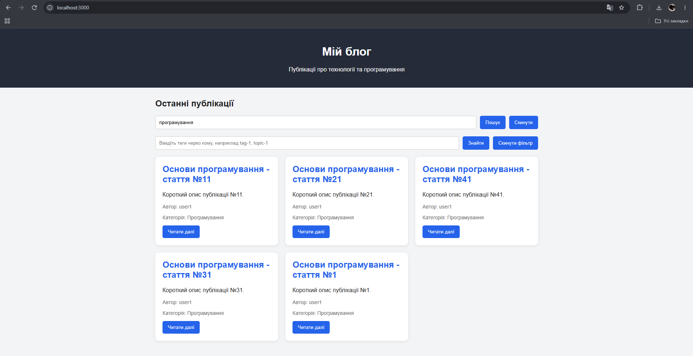


### Система рейтингів

1. Реалізувати можливість ставити лайки та дизлайки. [server.js](blog-app\server.js)
```
// Додавання лайка до публікації
app.post("/api/posts/:id/like", async (req, res) => {
    try {
        const postId = req.params.id;

        if (!ObjectId.isValid(postId)) {
            return res.status(400).json({
                error: "Некоректний ID публікації"
            });
        }

        const result = await db.collection("posts").updateOne(
            {
                _id: new ObjectId(postId),
                status: "published"
            },
            {
                $inc: {
                    "statistics.likes": 1
                }
            }
        );

        if (result.matchedCount === 0) {
            return res.status(404).json({
                error: "Публікацію не знайдено"
            });
        }

        const post = await db.collection("posts").findOne(
            { _id: new ObjectId(postId) },
            { projection: { statistics: 1 } }
        );

        res.json({
            message: "Лайк додано",
            likes: post.statistics.likes,
            dislikes: post.statistics.dislikes
        });

    } catch (error) {
        console.error(error);
        res.status(500).json({
            error: "Помилка додавання лайка"
        });
    }
});


// Додавання дизлайка до публікації
app.post("/api/posts/:id/dislike", async (req, res) => {
    try {
        const postId = req.params.id;

        if (!ObjectId.isValid(postId)) {
            return res.status(400).json({
                error: "Некоректний ID публікації"
            });
        }

        const result = await db.collection("posts").updateOne(
            {
                _id: new ObjectId(postId),
                status: "published"
            },
            {
                $inc: {
                    "statistics.dislikes": 1
                }
            }
        );

        if (result.matchedCount === 0) {
            return res.status(404).json({
                error: "Публікацію не знайдено"
            });
        }

        const post = await db.collection("posts").findOne(
            { _id: new ObjectId(postId) },
            { projection: { statistics: 1 } }
        );

        res.json({
            message: "Дизлайк додано",
            likes: post.statistics.likes,
            dislikes: post.statistics.dislikes
        });

    } catch (error) {
        console.error(error);
        res.status(500).json({
            error: "Помилка додавання дизлайка"
        });
    }
});
```
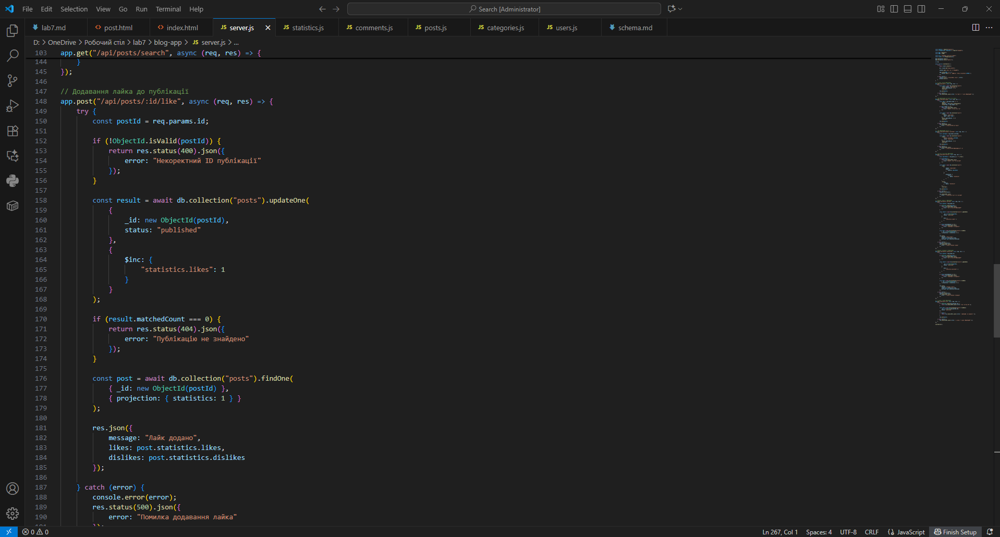

2. Зберігати результати оцінювання в базі даних.
```
db.posts.findOne(
|     { _id: ObjectId("6b0ad426d67406d4c4dbb057") },
|     { title: 1, statistics: 1 }
| )
```
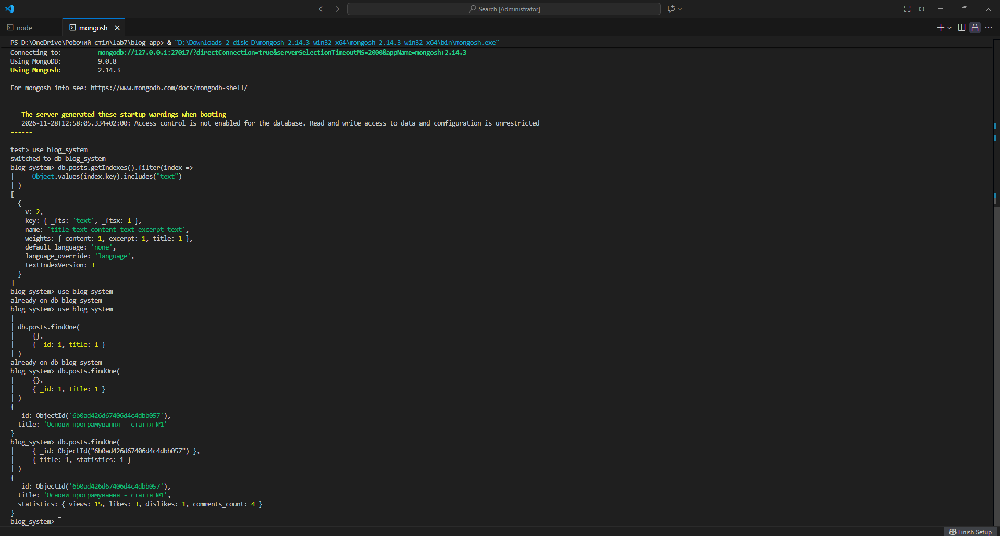

3. Відображати кількість лайків та дизлайків на сторінці поста. [post.html](blog-app\public\post.html)
```
<div class="rating">
    <h3>Оцініть публікацію</h3>

    <button onclick="ratePost('like')">
        👍 Лайк: <span id="likesCount">0</span>
    </button>

    <button onclick="ratePost('dislike')">
        👎 Дизлайк: <span id="dislikesCount">0</span>
    </button>

    <p id="ratingMessage"></p>
</div>

.rating {
    margin-top: 25px;
    padding: 20px;
    background: white;
    border-radius: 10px;
    box-shadow: 0 2px 8px #00000015;
}

.rating button {
    padding: 10px 15px;
    margin-right: 10px;
    margin-bottom: 10px;
    border: none;
    border-radius: 5px;
    background: #2563eb;
    color: white;
    cursor: pointer;
}

.rating button:hover {
    background: #1d4ed8;
}

#ratingMessage {
    color: #16a34a;
}

// Завантаження поточної кількості оцінок
async function loadRatingStats() {
    const postId = new URLSearchParams(window.location.search).get("id");

    try {
        const response = await fetch(`/api/posts/${postId}`);

        if (!response.ok) {
            throw new Error("Не вдалося завантажити оцінки");
        }

        const post = await response.json();

        document.getElementById("likesCount").textContent =
            post.statistics.likes;

        document.getElementById("dislikesCount").textContent =
            post.statistics.dislikes;

    } catch (error) {
        console.error(error);
    }
}


// Надсилання оцінки на сервер
async function ratePost(type) {
    const postId = new URLSearchParams(window.location.search).get("id");
    const message = document.getElementById("ratingMessage");

    try {
        const response = await fetch(`/api/posts/${postId}/${type}`, {
            method: "POST"
        });

        const result = await response.json();

        if (!response.ok) {
            throw new Error(result.error || "Не вдалося зберегти оцінку");
        }

        document.getElementById("likesCount").textContent =
            result.likes;

        document.getElementById("dislikesCount").textContent =
            result.dislikes;

        message.textContent = result.message;

    } catch (error) {
        message.textContent = error.message;
        console.error(error);
    }
}


// Завантаження оцінок при відкритті сторінки
loadRatingStats();
```
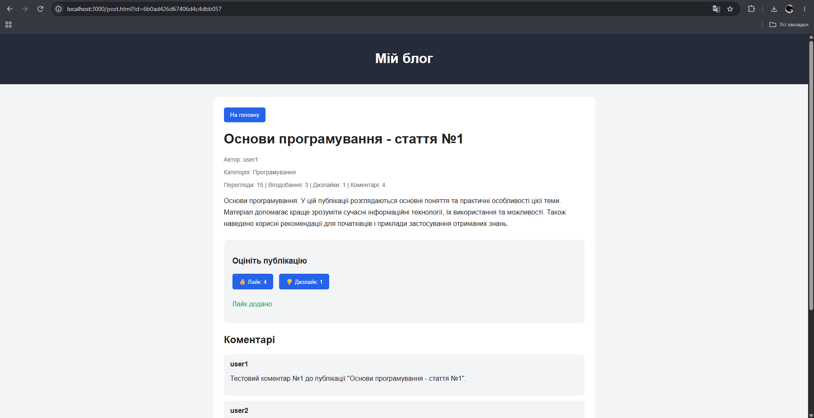


## Висновки
Під час виконання лабораторної роботи №7 я ознайомився з розробкою NoSQL-застосунків на основі MongoDB та Node.js. Створив базу даних blog_system із колекціями користувачів, публікацій і категорій, налаштував перевірку структури документів та індекси для швидшого пошуку.
Також я навчився додавати тестові дані, виконувати агрегатні запити для аналізу інформації та працювати з MongoDB через Node.js. Розробив вебінтерфейс блогу, реалізував API для отримання публікацій, пошуку за тегами й автором, повнотекстового пошуку, а також додав можливість оцінювати публікації за допомогою вподобань і дизлайків.
У результаті виконання дев'яти завдань я закріпив навички роботи з документними базами даних, створення серверної частини застосунку та взаємодії між вебінтерфейсом і базою даних MongoDB.