# Звіт з лабораторної роботи №5

## Загальна інформація
- ПІБ студента: Кравчук Владислав Вікторович
- Група:ІПЗ-31
- Рівень виконання:2

## 1 Рівень

### Аналіз трьох запитів через EXPLAIN ANALYZE
1. Перший запит:Аналіз товарів і категорій
``` sql
EXPLAIN ANALYZE
SELECT
    p.product_id,
    p.product_name,
    p.price,
    c.category_name
FROM products p
JOIN categories c ON p.category_id = c.category_id
WHERE p.price > 1000;
```
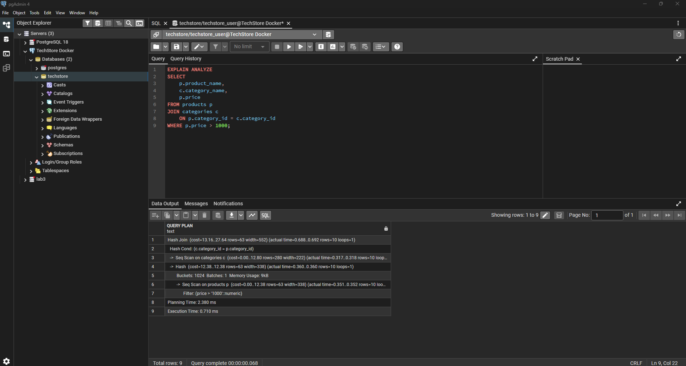

2. Другий запит:Аналіз замовлень клієнтів
``` sql
EXPLAIN ANALYZE
SELECT
    c.customer_id,
    c.full_name,
    COUNT(o.order_id) AS orders_count
FROM customers c
LEFT JOIN orders o ON c.customer_id = o.customer_id
GROUP BY c.customer_id, c.full_name;
```
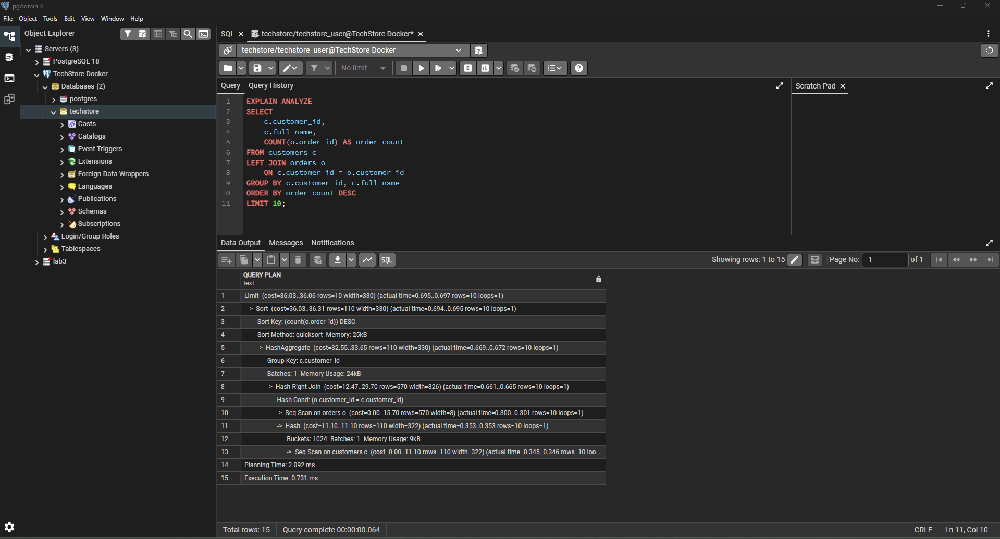

3. Третій запит:Аналіз товарів, які продавалися
``` sql
EXPLAIN ANALYZE
SELECT
    p.product_id,
    p.product_name,
    SUM(oi.quantity) AS sold_quantity
FROM products p
JOIN order_items oi ON p.product_id = oi.product_id
GROUP BY p.product_id, p.product_name
HAVING SUM(oi.quantity) > 1;
```
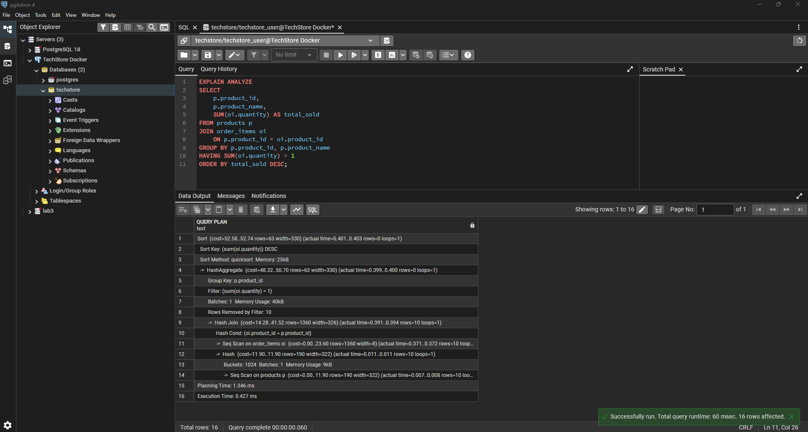

### Створення трьох індексів
1. Створення індексів
``` sql
CREATE INDEX idx_products_price
ON products(price);

CREATE INDEX idx_customers_email
ON customers(email);

CREATE INDEX idx_orders_order_date
ON orders(order_date);
```
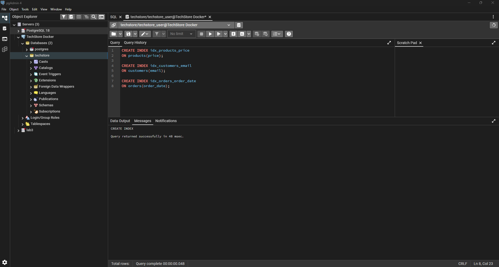

2. Перевірка роботи індексу
``` sql
EXPLAIN ANALYZE
SELECT *
FROM products
WHERE price > 1000;
```
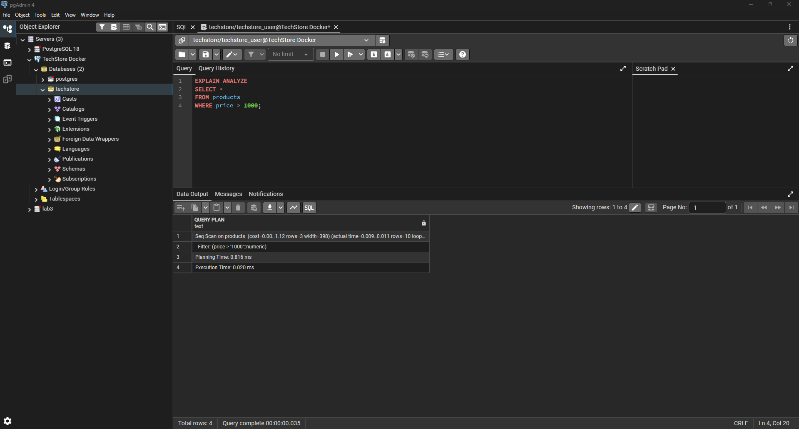

### Створення двох VIEW
1. Представлення з інформацією про товари
``` sql
CREATE VIEW product_details AS
SELECT
    p.product_id,
    p.product_name,
    b.brand_name,
    c.category_name,
    p.price,
    p.quantity
FROM products p
LEFT JOIN brands b
    ON p.brand_id = b.brand_id
LEFT JOIN categories c
    ON p.category_id = c.category_id;
```
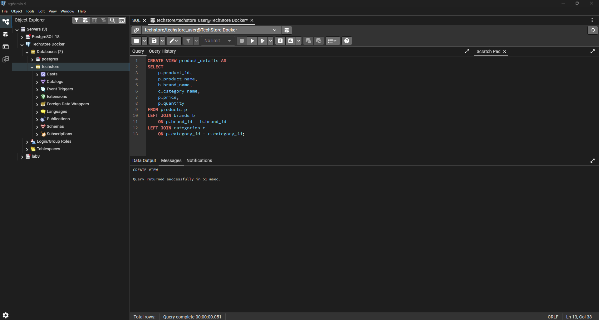

2. Створення представлення із замовленнями
``` sql
CREATE VIEW customer_orders AS
SELECT
    o.order_id,
    c.full_name,
    c.email,
    o.order_date,
    o.status,
    o.total_amount
FROM orders o
JOIN customers c
    ON o.customer_id = c.customer_id;
```
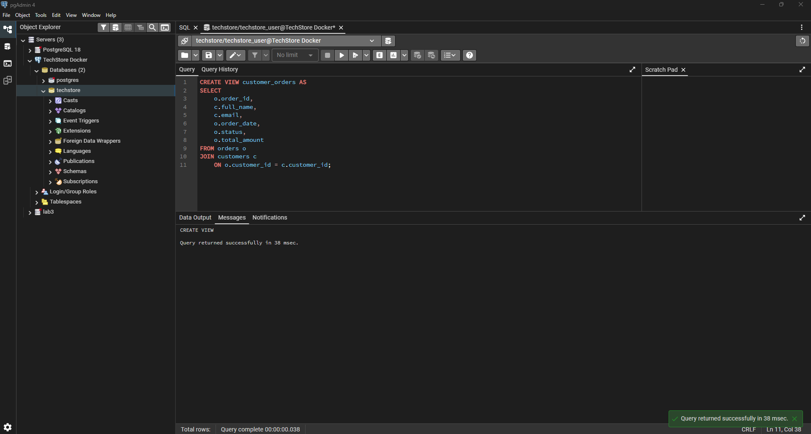

3. Перевірка
``` sql
SELECT * FROM product_details
LIMIT 10;
```
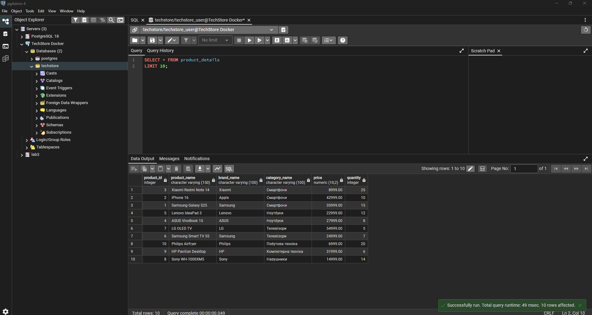
``` sql
SELECT * FROM customer_orders
LIMIT 10;
```
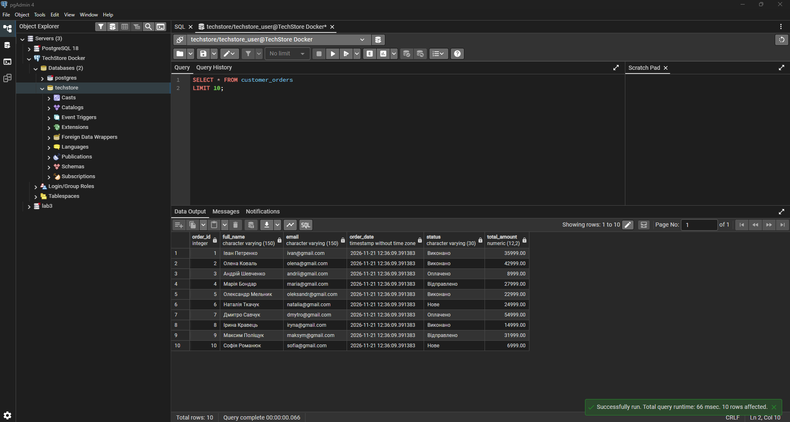

### Тригер логування INSERT / UPDATE
1. Створення таблиці журналу
``` sql
CREATE TABLE product_log (
    log_id SERIAL PRIMARY KEY,
    product_id INTEGER,
    action_type VARCHAR(20),
    action_time TIMESTAMP DEFAULT CURRENT_TIMESTAMP
);
```
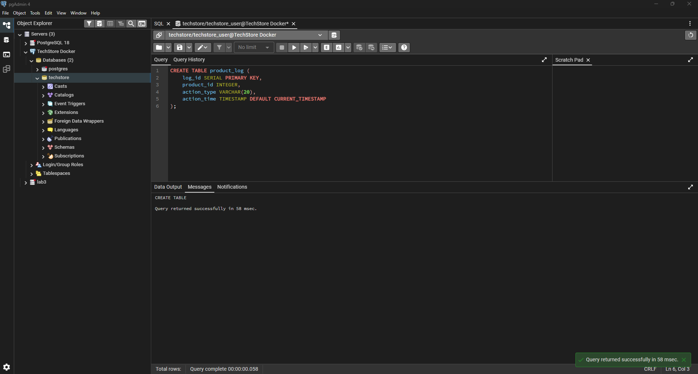

2. Створення функції логування
``` sql
CREATE OR REPLACE FUNCTION log_product_changes()
RETURNS TRIGGER AS $$
BEGIN
    IF TG_OP = 'INSERT' THEN
        INSERT INTO product_log (product_id, action_type)
        VALUES (NEW.product_id, 'INSERT');

    ELSIF TG_OP = 'UPDATE' THEN
        INSERT INTO product_log (product_id, action_type)
        VALUES (NEW.product_id, 'UPDATE');
    END IF;

    RETURN NEW;
END;
$$ LANGUAGE plpgsql;
```
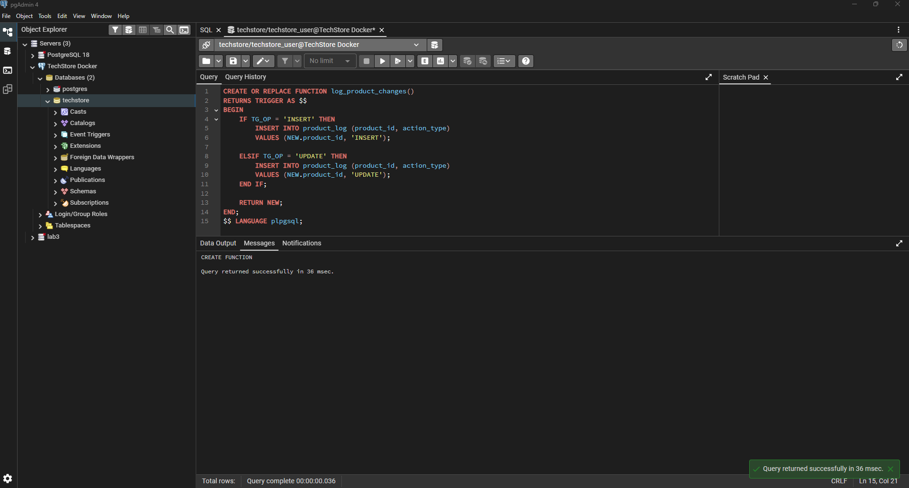

3. Створення тригера
``` sql
CREATE TRIGGER trg_product_changes
AFTER INSERT OR UPDATE ON products
FOR EACH ROW
EXECUTE FUNCTION log_product_changes();
```
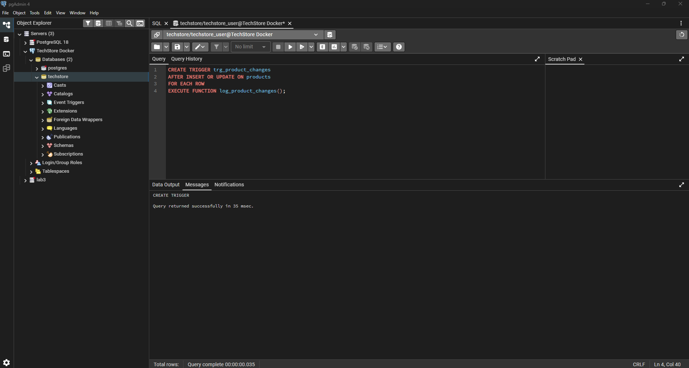

4. Перевірка тригера
``` sql
UPDATE products
SET price = price
WHERE product_id = (
    SELECT MIN(product_id) FROM products
);
```
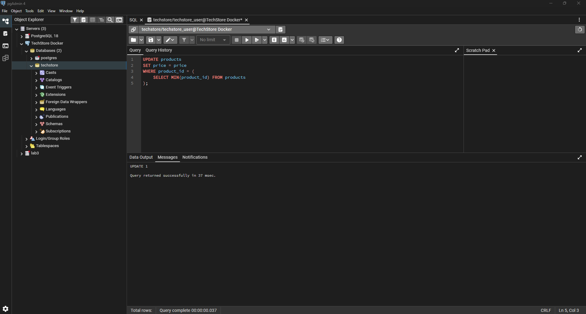
``` sql
SELECT *
FROM product_log
ORDER BY log_id DESC
LIMIT 10;
```
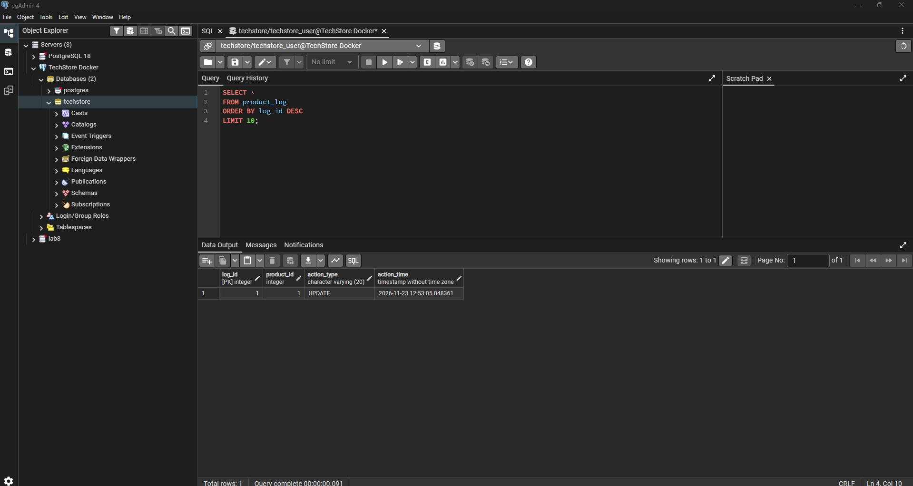

### Користувач з обмеженими правами
1. Створення користувача
``` sql
CREATE USER report_viewer
WITH PASSWORD 'Viewer12345';
```
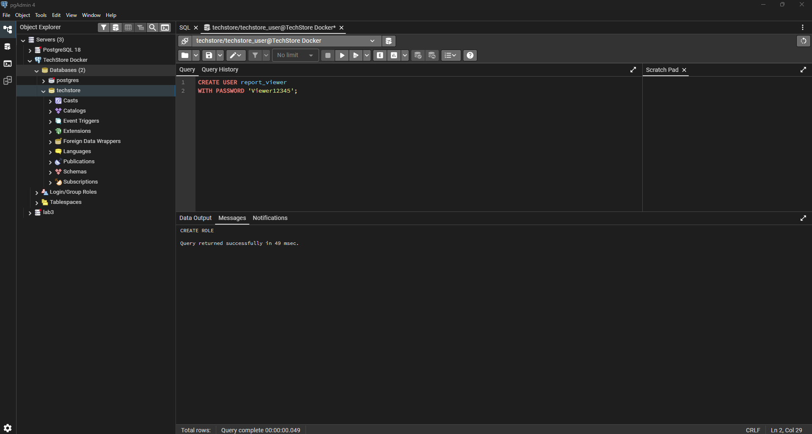

2. Надання прав
``` sql
GRANT CONNECT ON DATABASE techstore TO report_viewer;

GRANT USAGE ON SCHEMA public TO report_viewer;

GRANT SELECT ON products, categories TO report_viewer;

GRANT SELECT ON product_details, customer_orders TO report_viewer;
```
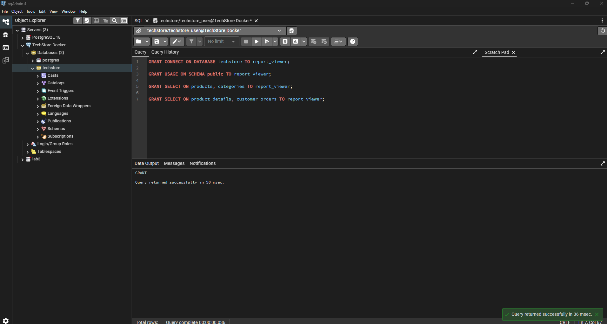

3. Перевірка наданих прав
``` sql
SELECT
    grantee,
    table_name,
    privilege_type
FROM information_schema.role_table_grants
WHERE grantee = 'report_viewer'
ORDER BY table_name;
```
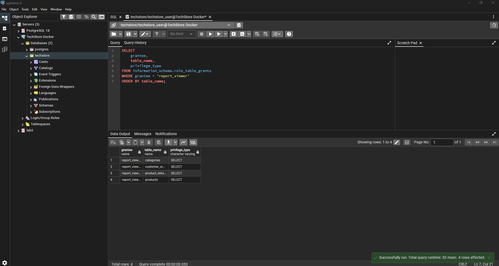

## 2 Рівень

### Створення VIEW з правилом RULE
1. Створення представлення
``` sql
CREATE VIEW product_price_view AS
SELECT
    p.product_id,
    p.product_name,
    p.price,
    b.brand_name
FROM products p
LEFT JOIN brands b
    ON p.brand_id = b.brand_id;
```
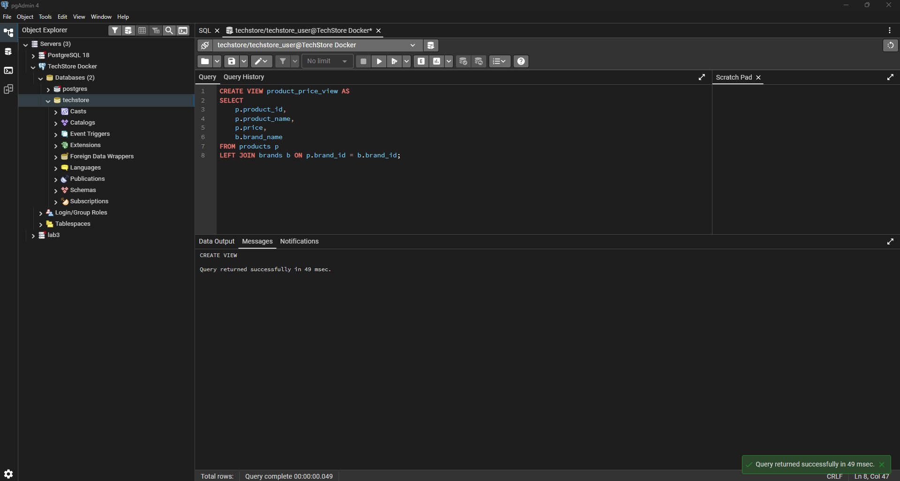

2. Створення правила оновлення
``` sql
CREATE RULE product_price_update AS
ON UPDATE TO product_price_view
DO INSTEAD
    UPDATE products
    SET price = NEW.price
    WHERE product_id = OLD.product_id;
```
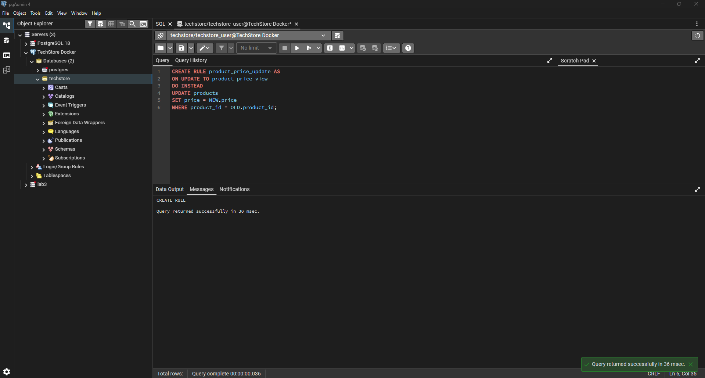

3. Перевірка роботи правила
``` sql
UPDATE product_price_view
SET price = price
WHERE product_id = (
    SELECT MIN(product_id) FROM products
);
```
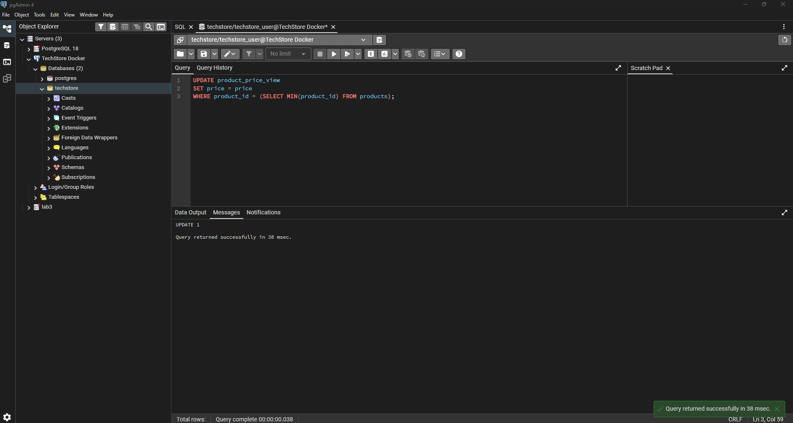

### Тригер перевірки даних
1. Створення функції перевірки
``` sql
CREATE OR REPLACE FUNCTION validate_product()
RETURNS TRIGGER AS $$
BEGIN
    IF NEW.price <= 0 THEN
        RAISE EXCEPTION 'Ціна товару повинна бути більшою за 0';
    END IF;

    IF NEW.quantity < 0 THEN
        RAISE EXCEPTION 'Кількість товару не може бути від''ємною';
    END IF;

    RETURN NEW;
END;
$$ LANGUAGE plpgsql;
```
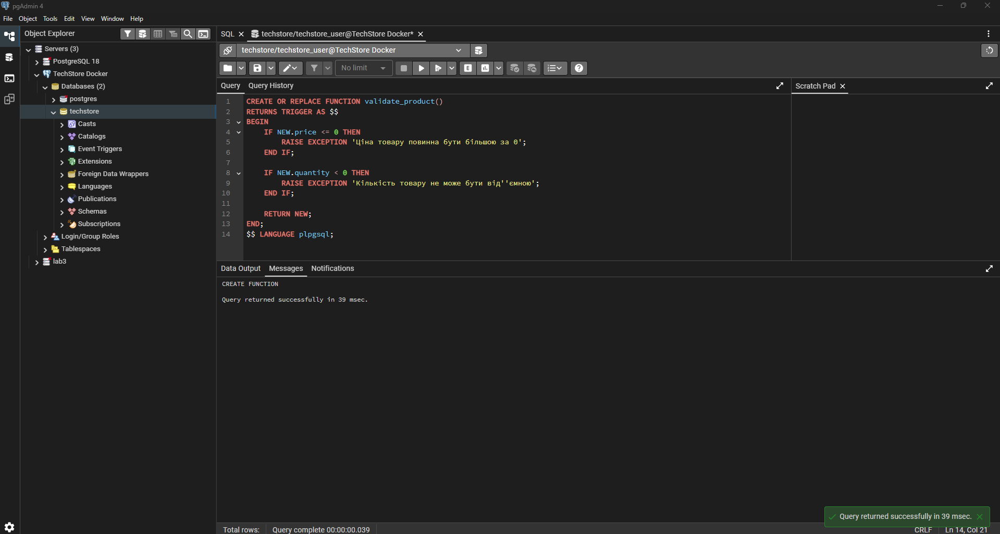
2. Створення тригера
``` sql
CREATE TRIGGER trg_validate_product
BEFORE INSERT OR UPDATE ON products
FOR EACH ROW
EXECUTE FUNCTION validate_product();
```
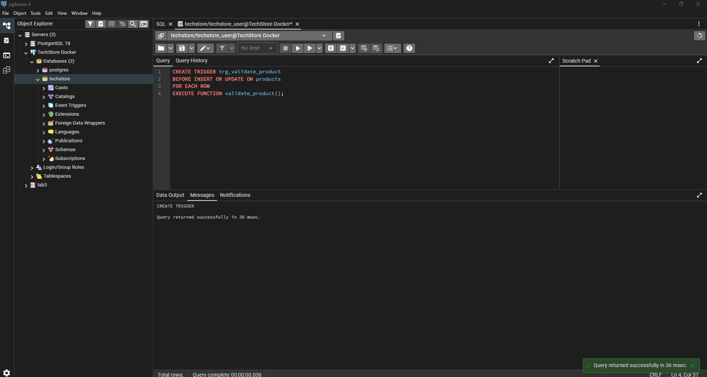
3. Перевірка роботи тригера
``` sql
UPDATE products
SET price = -100
WHERE product_id = (
    SELECT MIN(product_id) FROM products
);
);
```
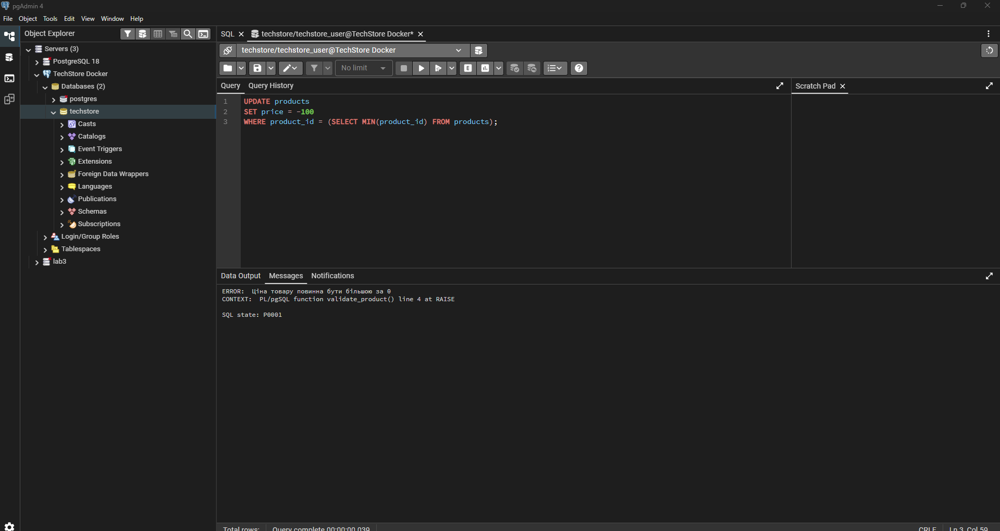

### Повна система логування INSERT / UPDATE / DELETE
1. Створення таблиці журналу
``` sql
CREATE TABLE audit_log (
    log_id SERIAL PRIMARY KEY,
    table_name VARCHAR(50) NOT NULL,
    operation VARCHAR(10) NOT NULL,
    record_id INTEGER,
    old_values JSONB,
    new_values JSONB,
    changed_by VARCHAR(100),
    changed_at TIMESTAMP DEFAULT NOW()
);
```
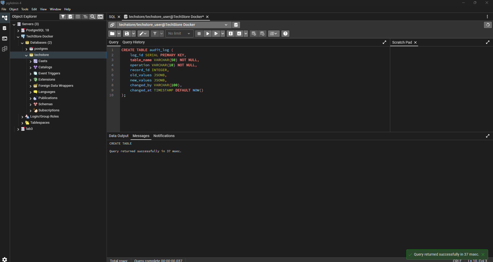
2. Створення функції аудиту
``` sql
CREATE OR REPLACE FUNCTION comprehensive_audit_log()
RETURNS TRIGGER AS $$
BEGIN
    INSERT INTO audit_log (
        table_name,
        operation,
        record_id,
        old_values,
        new_values,
        changed_by
    )
    VALUES (
        TG_TABLE_NAME,
        TG_OP,
        COALESCE(NEW.product_id, OLD.product_id),
        CASE
            WHEN TG_OP IN ('UPDATE', 'DELETE')
            THEN to_jsonb(OLD)
            ELSE NULL
        END,
        CASE
            WHEN TG_OP IN ('INSERT', 'UPDATE')
            THEN to_jsonb(NEW)
            ELSE NULL
        END,
        current_user
    );

    RETURN COALESCE(NEW, OLD);
END;
$$ LANGUAGE plpgsql;
```
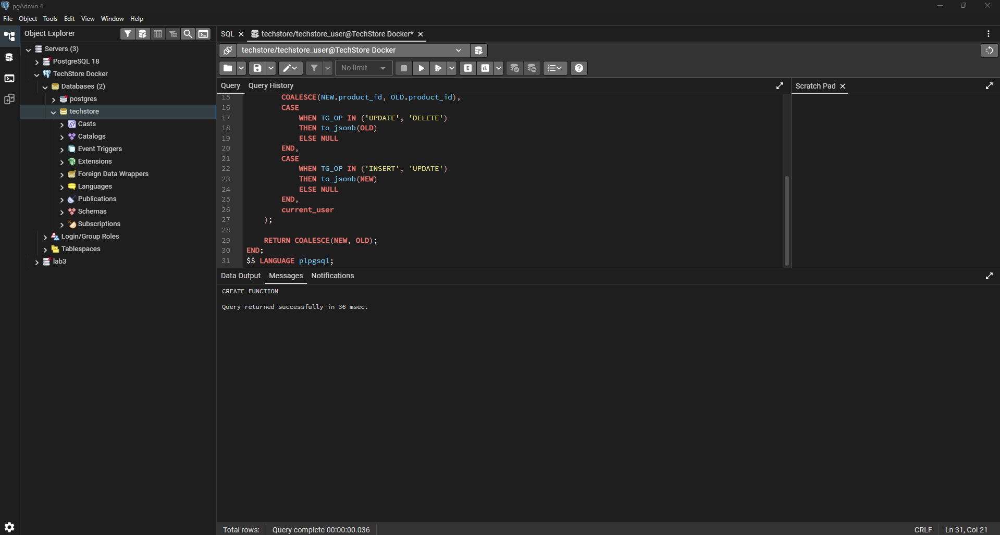
3. Створення тригера аудиту
``` sql
CREATE TRIGGER trg_comprehensive_audit
AFTER INSERT OR UPDATE OR DELETE ON products
FOR EACH ROW
EXECUTE FUNCTION comprehensive_audit_log();
```
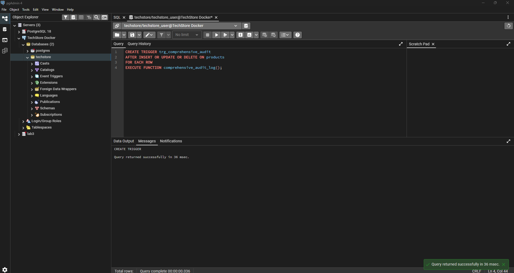
4. Створення тестового запису в журналі
``` sql
UPDATE products
SET price = price
WHERE product_id = (SELECT MIN(product_id) FROM products);
```
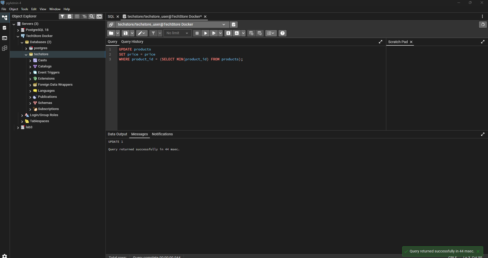
5. Перегляд журналу
``` sql
SELECT *
FROM audit_log
ORDER BY log_id DESC
LIMIT 5;
```
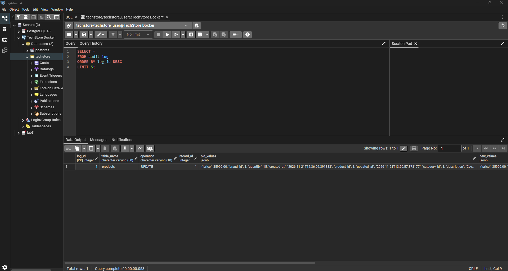

### Часткові індекси
1. Створення індексу для дорогих товарів
``` sql
CREATE INDEX idx_expensive_products
ON products(price)
WHERE price > 1000;
```

2. Створення індексу для доставлених замовлень
``` sql
CREATE INDEX idx_delivered_orders
ON orders(order_date)
WHERE status = 'delivered';
```

3. Оновлення статистики таблиць
``` sql
ANALYZE products;
ANALYZE orders;
```
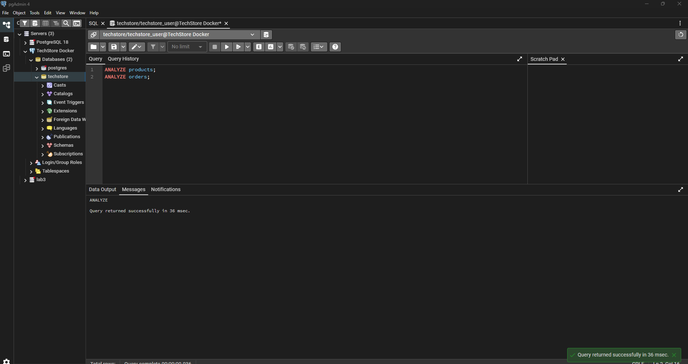
4. Перевірка запиту для товарів
``` sql
EXPLAIN ANALYZE
SELECT *
FROM products
WHERE price > 1000;
```
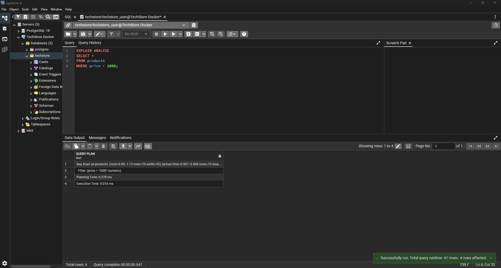
5. Перевірка запиту для замовлень
``` sql
EXPLAIN ANALYZE
SELECT *
FROM orders
WHERE status = 'delivered';
```
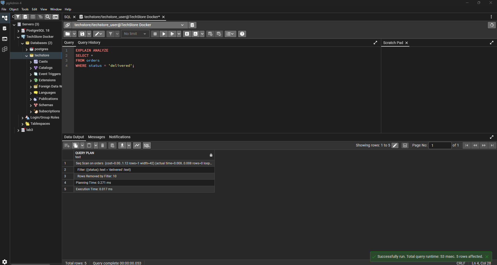

### Резервне копіювання та відновлення
1. Перевірка запущеного контейнера
``` powershell
docker ps
```
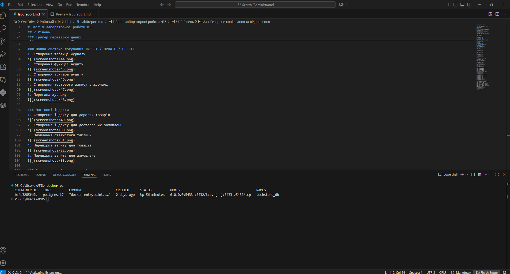
2. Створення резервної копії
``` powershell
docker exec bc4b3285fb7d pg_dump -U techstore_user -d techstore -F c -f /tmp/techstore_backup.dump
```
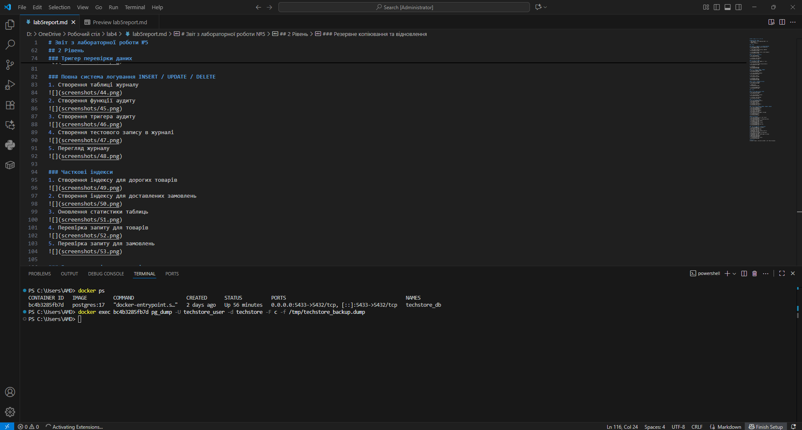
3. Копіювання резервної копії на комп'ютер
``` powershell
docker cp bc4b3285fb7d:/tmp/techstore_backup.dump .\techstore_backup.dump
```
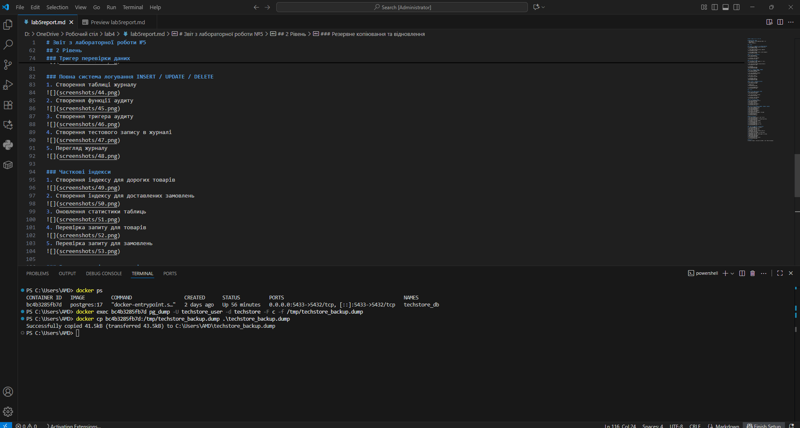
4. Створення окремої бази для відновлення
``` powershell
docker exec bc4b3285fb7d createdb -U techstore_user techstore_restore
```
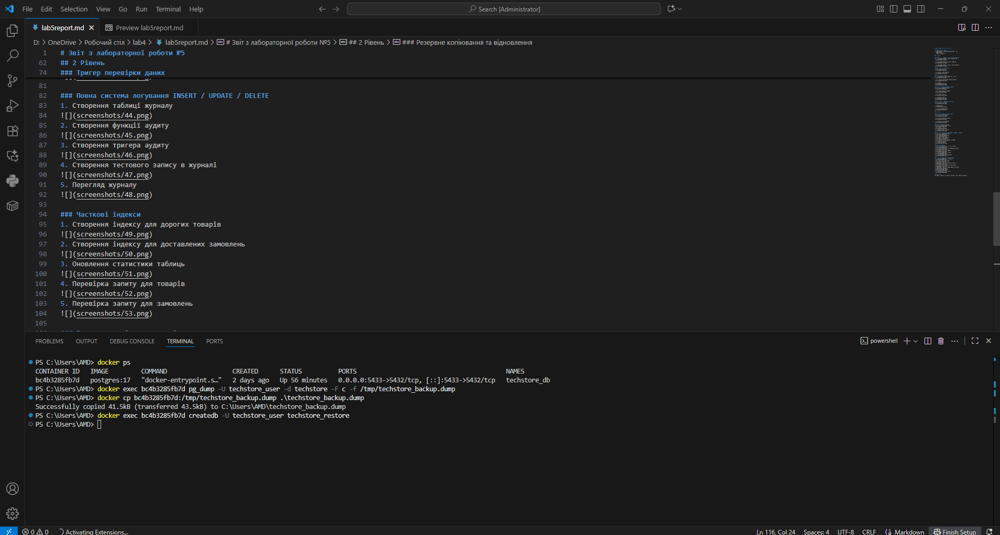
5. Копіювання резервної копії назад у контейнер
``` powershell
docker cp .\techstore_backup.dump bc4b3285fb7d:/tmp/techstore_backup.dump
```
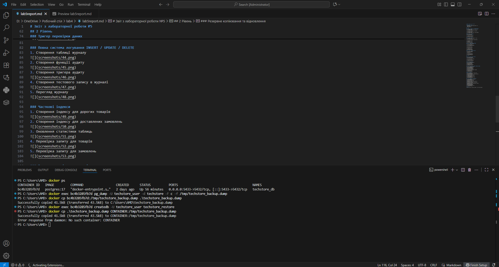
6. Відновлення бази даних
``` powershell
docker exec bc4b3285fb7d pg_restore -U techstore_user -d techstore_restore --no-owner /tmp/techstore_backup.dump
```
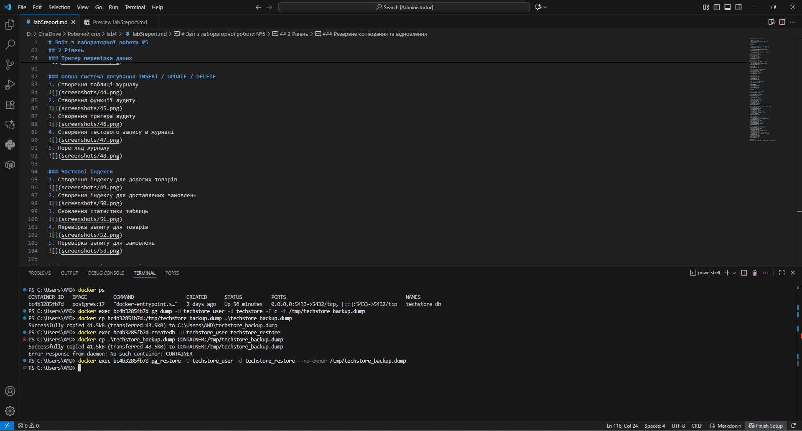
7. Перевірка кількості товарів
``` sql
SELECT COUNT(*) FROM products;
```
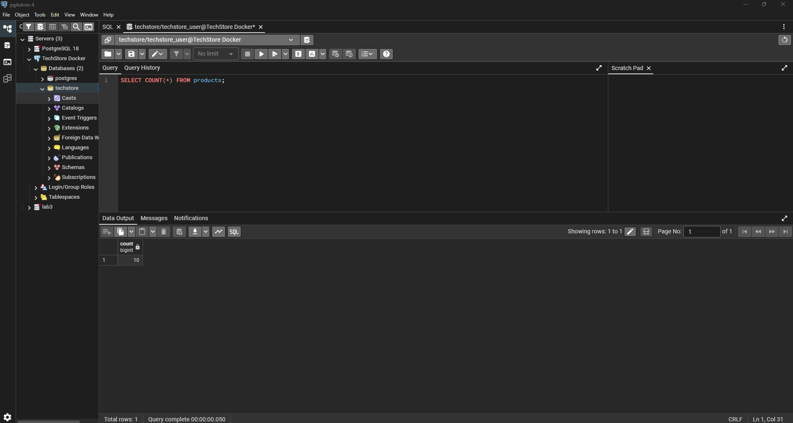

## Висновки
Під час виконання лабораторної роботи №5 я навчився працювати з індексами, представленнями VIEW, правилами RULE та тригерами в PostgreSQL. Виконав аналіз SQL-запитів за допомогою EXPLAIN ANALYZE, створив механізми перевірки даних і журналювання змін у таблицях. Також ознайомився з налаштуванням прав доступу користувачів і створенням часткових індексів. Окремо виконав резервне копіювання бази даних за допомогою Docker та відновлення її копії в окрему базу. У результаті отримав практичні навички адміністрування PostgreSQL, оптимізації запитів і автоматизації роботи з базами даних.